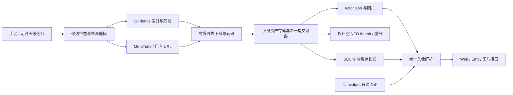

# 演员资料目录与 GFriends 接入实施计划

更新日期：2026-10-12。状态：演员资料/GFriends 与实例设置功能已在 `fddf3ef` 提交并推送。代理及前端执行环境阻塞已解除，前端单测、正式构建、演员/P5 桌面和移动端验收已通过（见 10.3）。本轮新增独立演员管理页面与一键批量入口，相关验证通过（见 10.4）；真实 Emby 客户端和 Linux 实机验收仍待进行，既有 Go 回归基线限制仍保留。未部署。

本计划落实本次确定的方向：为演员头像及相关资料规定统一目录，并在 Emby-go 内接入 GFriends。项目按用户明确的开源、非商业用途推进，继续沿用现有 MIT 代码许可证；第三方图片与索引的来源条件单独记录。

**目录统一为数据库同级的 `actors/`，允许通过 `actors_dir` 指定其他位置。每位演员有独立资料目录，头像、姓名信息、来源记录和未完成操作均能随该目录备份。** GFriends 索引缓存在同一根目录下，保留可独立清除的缓存边界。

本文是后续实施和进度更新的主文档。调研报告中的索引格式、别名歧义和现有链路分析继续有效；目录设计、恢复状态存储及任务拆分以本计划为准。本文不依赖被 Git 忽略的本地调研报告即可执行。

## 1. 范围与完成条件

首版覆盖：

- 明确演员资料根目录、每人子目录、版本化 JSON 与头像文件格式。
- 读取兼容旧 `avatars/`，提供可预览、可恢复的复制导入。
- 原生 GFriends 索引下载、缓存、精确匹配、歧义识别和图片获取。
- 将头像能力从 MetaTube 配置检查中拆开，保留 MetaTube 作为原有模式和可选回退。
- 补齐缺失本地副本、图片 Tag、部分 NFO 更新及中断续作。
- 接入现有手动任务、定时任务、设置页面、进度、取消与图片接口。
- 完成备份、恢复、发布分发和来源说明。

首版只存有来源依据的姓名、别名、头像与来源信息。GFriends 不提供通用人物档案，本期不抓取生日、身高、简介等额外资料，不预填虚构字段；将来增加资料字段时通过 `actor.json` 的版本兼容扩展。也不在本期实现人物自动合并、批量替换已有头像、人脸裁剪模型或全仓图片镜像。

完成条件：不配置 MetaTube 时可通过 GFriends 补全唯一命中的演员；已有头像和非空 NFO 数据得到保护；重启、部分写入失败、重复执行和索引重建后能够恢复；Web 与 Emby 兼容客户端能读取新头像；旧头像仍可显示，导入不删除源文件。

## 2. 目录规范

### 2.1 根目录与配置优先级

拟新增顶层 YAML 配置：

```yaml
db_path: "emby-go.db"
actors_dir: ""  # 留空：解析后的数据库文件所在目录 / actors
```

路径规则：

1. 启动时先把 `db_path` 按现有程序工作目录规则解析为绝对路径。
2. `actors_dir` 为空时使用该数据库目录下的 `actors`。
3. `actors_dir` 是绝对路径时直接使用；是相对路径时以数据库目录为基准解析，保证随数据库数据目录组织。
4. 对外显示最终绝对路径；运行中的任务持有启动时的目录配置快照。
5. 根目录属于实例级存储配置，改配置并重启生效。改路径不会自动移动数据；迁移必须执行显式复制/导入流程。

部署示例：数据库为 `/var/lib/emby-go/emby-go.db` 时，默认演员资料根目录为 `/var/lib/emby-go/actors`。这与当前 systemd 服务的 `/var/lib/emby-go` 工作及数据目录一致。

现有 SQLite 设置 `scrape.avatars_dir` 继续用于定位旧头像，未配置时仍按原规则读取数据库同级 `avatars/`。新目录和旧目录不互相覆盖。新头像任务写入 `actors/`；旧目录作为兼容读取和显式导入的来源。

`actors_dir` 不设置在发布包内部，也不主动注册为媒体库。第一次需要持久化时创建目录并校验权限；不可写时给头像任务明确错误，不因此破坏已有媒体的只读浏览。

### 2.2 固定目录形态

```text
<actors_dir>/
  layout.json                         # 根目录格式版本
  people/
    <actor-key 前两位>/
      <actor-key>/
        actor.json                    # 姓名、已核验别名、当前本地头像和来源
        images/
          <image-sha256>.webp          # 最终 WebP 内容的 SHA-256，写成后不原地改写
        pending.json                  # 仅在操作未完成时存在，供中断恢复
  cache/
    gfriends/
      <source-key>/
        Filetree.json                 # 上游原始索引，保留来源顺序
        http.json                     # ETag、版本、最后成功检查时间等
  migrations/
    <旧来源目录摘要>.json              # 可续作的导入范围、尝试次数和结果
```

`people/`、`migrations/` 和根格式文件属于需要备份的数据；`pending.json` 在任务进行中也必须保留。`cache/` 可单独清除并重建，但正在运行的任务使用自己的不可变索引快照。实现中下载和转码使用有界内存，原子落盘的临时文件使用目标文件同目录的随机 `.tmp` 名，以保证同文件系统替换，正常退出时清理。中断恢复依赖已写好的不可变图片与 pending，不依赖临时下载文件。

首版只管理每人当前选中的一张头像，不一次下载其全部图片。不提供整棵 `actors/` 的静态 HTTP 服务；头像端点只返回服务校验过的图片文件，不能暴露 JSON、缓存或包含媒体路径的恢复记录。

### 2.3 演员键与兼容原则

`actor-key = hex(SHA-256(UTF-8(strings.TrimSpace(本地演员名))))`，使用完整 64 位小写十六进制字符串，前两位仅用于目录分片。

这里保留姓名大小写及其他字符，与当前数据库按姓名区分演员的方式一致；不能使用 GFriends 的别名匹配归一化规则生成身份键。演员名、中文名、日文名和罗马字之间的相似关系不构成自动合并授权。

读取时检查 `actor.json` 中的姓名能否计算出所在目录键；不一致则报告损坏或冲突，不将资料静默绑定给另一人。原有 Person ID、影片演员名单、参演关系保持原有规则。演员改名或合并属于未来明确操作，不由头像任务顺带进行。

旧头像按现有规则定位：姓名去首尾空白、小写后 SHA-256 的前 16 位，再加 `.webp`。旧键只用于查找旧文件，不作为新目录键。若不同数据库姓名映射到同一个旧文件，导入预览标为归属冲突，不盲目认定是同一人。

### 2.4 为什么头像使用内容文件名

头像转码后计算实际 WebP 字节的 SHA-256，以摘要为文件名。同样的结果不会生成重复文件；新图先完整写入，再通过原子替换 `actor.json` 切换当前引用。

这样不必假设“图片文件和 JSON 能一起原子写入”。JSON 发布之前旧头像仍可用，发布之后新路径对应完整的新图。`avatar_tag` 由最终服务的图片内容生成，避免来源字节没变而转码结果已变时客户端仍使用旧 Tag。

首版不自动删除旧来源文件或未引用图片。由于默认只补缺失，更新量有界；后续若实际出现明显的未引用图片积累，再提供带预览和保留规则的清理功能。

## 3. actor.json 与数据归属

### 3.1 最小格式

下面是结构示意，尖括号值是占位符，不是可直接导入的真实记录：

```json
{
  "schema_version": 1,
  "name": "三上悠亜",
  "aliases": [],
  "avatar": {
    "file": "images/<image-sha256>.webp",
    "sha256": "<最终 WebP 文件完整 SHA-256>",
    "width": 600,
    "height": 900,
    "origin": "gfriends",
    "source_url": "<不含凭据的规范图片 URL>",
    "group": "0-Hand-Storage",
    "source_file": "三上悠亜.jpg",
    "source_version": "1637650805",
    "index_version": "<索引内容摘要>",
    "index_timestamp": "<上游原始时间戳字符串，保留小数精度>",
    "downloaded_at": "<UTC RFC3339 时间>"
  },
  "created_at": "<UTC RFC3339 时间>",
  "updated_at": "<UTC RFC3339 时间>"
}
```

约定：

- `schema_version`、`name` 为必填；暂无头像时省略 `avatar`，不写伪路径。
- `aliases` 只保存唯一匹配记录提供的关系，每项包含 `name` 和 `source`（`gfriends/来源组` 或 `metatube/提供者`）；暂无证据时省略或为空。不能把所有相同短别名连接成一个人物集合。早期字符串别名按 `legacy_manifest` 来源读取，不反推原提供者。
- `origin` 支持本期需要的 `gfriends`、`metatube`、`legacy_local` 和 `nfo`；`nfo` 表示从影片原有 URL 恢复。旧图缺少远端 URL 时省略相关字段，不编造来源。
- `source_version` 记录 GFriends 图片 URL 的 `t` 参数；`index_version` 和 `index_timestamp` 分别保存索引内容摘要与原始小数时间戳。`downloaded_at` 仅记录网络头像；修复下载保留原人物创建时间和别名来源。
- `source_url` 描述当前本地图像的来源，不存 GitHub Token、MetaTube Token、代理密码或私密请求头。来源 URL 含凭据时不照抄进清单，应使用可公开的规范地址或省略并记录不可移植原因。
- `avatar.file` 必须是当前演员目录内的受控相对路径。拒绝绝对路径、`..`、穿越演员目录的链接以及任意 JSON 指定的外部文件。
- 格式升级保持向后读取；遇到比当前程序更新且不兼容的版本，停止写入该记录并显示原因，不能重建为空记录覆盖。

### 3.2 明确每种数据的权威位置

| 数据 | 权威位置与规则 |
|---|---|
| 影片演员名单、角色和影片其他元数据 | 影片 NFO，仍按现有扫描语义读取 |
| 每部影片自己的 `<actor><thumb>` | 对应影片 NFO，已有非空值默认保留 |
| 当前本地演员肖像的文件、来源和已核验资料 | 演员目录中的 `actor.json`；不由后续某一部影片的重扫随意替换 |
| 图片内容 | `images/<sha256>.webp`，按清单引用与摘要校验 |
| 列表、搜索、头像 Tag 等读取索引 | SQLite / 进程缓存，可由 NFO 和演员目录恢复 |
| 尚未完成的下载发布、NFO 补写与重扫 | `pending.json`；它是操作恢复记录，不是另一份演员资料 |
| GFriends 姓名候选和来源顺序 | 当前可用的上游索引快照，属于可重建缓存 |

统一目录带来的明确变化是：本地演员资产有了自己的完整清单，而不再只有一张匿名哈希图片。这不将影片元数据迁出 NFO，也不把多个影片中不同的 thumb 强行改成同一个值。

当 NFO 原 URL 与已有本地资产来源不一致时，记录来源差异并保留双方；不能用某部影片后扫描到的 URL 静默替换演员头像。需要换图时走未来明确的替换操作。没有本地资产时，已有一致的 NFO URL 可作为恢复来源；多部影片提供互相冲突的 URL 时保守跳过自动认定。

数据库重建后的路径为：扫描 NFO 恢复演员及关系 → 按演员键读取本地资产清单 → 恢复可用头像路径和 Tag。没有本地副本的 URL 留给后台修复任务处理；扫描和图片 GET 本身不访问互联网。

## 4. 开源分发约定

按已明确的非商业使用方向继续实施，不再设置商业授权确认作为开发前置条件。

实施时保留现有 `LICENSE`，新增项目可分发的第三方数据来源说明，说明 GFriends 的项目地址、用途、图片权利归属和 README 中的使用条件。说明项目代码的 MIT 与第三方图片/索引各自适用的条件，不将下载数据重新标为本项目 MIT 数据。

源码、Git 历史、二进制发布包及测试资产不附带整份 GFriends 索引或演员照片。程序在用户明确选择并保存 GFriends 来源后按需下载；离线单元测试使用人工构造的小型 JSON 与生成的测试图片。

实现目录功能时增加默认运行目录 `/actors/`、旧 `/avatars/` 的精确 Git 忽略规则及发布包排除规则，不使用会误伤项目图片或测试文件的全局扩展名忽略。

## 5. 接入结构与配置

### 5.1 模块职责



拟新增 `internal/actorassets` 统一负责演员路径、清单读写、内容图片、操作日志、旧文件兼容及恢复。现有 `internal/avatar` 中的旧命名规则保留为兼容 helper。服务端详情、列表、图片端点和头像任务都通过同一个资产解析器，不能有的入口读新目录、有的入口仍直接调用旧 `avatar.Path`。

拟新增 `internal/gfriends` 只负责上游索引、HTTP 获取、匹配及候选信息，不直接写影片 NFO 或 SQLite。`internal/scraper` 保留任务编排。首版不建立泛化插件平台或人物主键重构。

### 5.2 来源和配置兼容

头像来源支持 `metatube`、`gfriends`、`gfriends_then_metatube`。推荐新启用 GFriends 的用户选择后两者；已有配置没有新字段时继续使用原来的 MetaTube 行为，不静默启用外部来源。

影片刮削继续使用原 `Configured()`；头像任务增加自己的配置判断，覆盖手动入口、定时入口和直接调用。GFriends 模式不要求 MetaTube URL 或 Token。

`actors_dir` 在实例 YAML 中设置，不与 SQLite 设置重复维护两份根目录。来源、刷新间隔等仍通过现有刮削设置接口显式保存。接口增加 `actor_storage_dir`（解析后的只读绝对路径）、`avatar_source`、`avatar_configured` 和 GFriends 状态；现有 `avatars_dir` 字段保留旧来源目录含义及兼容读写，界面明确其用途，不能冒充新目录。

旧目录配置的修改只影响之后的兼容查找/导入，不移动新资产。运行中任务的目录和来源快照不受表单修改影响。新根目录切换在重启后生效，并更新相关缓存作用域。

### 5.3 GFriends 的固定规则

- 索引地址默认 `https://raw.githubusercontent.com/gfriends/gfriends/master/Filetree.json`，图片根地址对应同一仓库；镜像是显式配置。
- 按 `Content` 的出现顺序保留来源优先级，不能依赖 Go map 遍历顺序。保存原始 JSON，并构建内存姓名到候选的反向索引。
- 使用姓名键查找，使用映射值中的真实文件名下载；正确处理查询参数、Unicode 路径、`AI-Fix-` 和多图编号。
- 精确匹配也必须检查不同人物目标。短别名歧义跳过；先确认同人，再比较图片质量。别名只影响查图，不自动合并本地演员。
- 推荐索引刷新周期 24 小时、图片并发 2；首次下载与每轮任务共享一份快照。索引下载/解析失败时保留同一来源的旧快照。
- 缓存按规范来源身份的摘要分区；同一来源刷新合并，网络读取与解析在锁外完成，短锁发布校验通过的不可变版本。旧配置的请求不能覆盖新来源。
- 索引版本时间按实际数值处理；调研快照中的 `Timestamp` 是带小数的 Unix 秒值，不能误按整数微秒解析。
- 下载校验状态码、响应格式、解压字节上限、图像像素上限和重定向目标；取消和有限重试遵守任务 context。每个图片源独立处理故障，不携带 MetaTube 鉴权访问公开仓库。

本次调研快照为 `7c34e9681382789a84e980c228023e716509d350`：索引 6,502,686 字节、51 个来源、107,664 条姓名映射。`三上悠亜.jpg` 命中 14 个来源，`三上悠亚.jpg` 未命中；`あかり.jpg` 命中 33 个来源并指向多个不同姓名。它们用于设计验证，不能作为用户真实媒体库覆盖率或未来数据稳定性的承诺。

## 6. 提交、修复与旧目录导入

### 6.1 候选处理顺序

1. 当前资产清单指向有效图片：保留，仅修复缺失的索引 Tag。
2. 新目录无有效资产、旧目录存在唯一可归属图片：继续兼容显示，优先导入本地图，不联网覆盖。
3. 有原 NFO URL、无本地副本：优先按原 URL 恢复；来源冲突或下载失败要记录，不能偷偷换图。
4. URL 和本地副本都缺失：查询 GFriends；未命中或不可用时按配置考虑 MetaTube。
5. 存在 `pending.json`：优先恢复未完成步骤，不因数据库 URL 已非空而排除。

处理上限应用于实际待处理集合，未命中、歧义和临时来源故障区分计数；取消不能抹掉已经完成的操作记录。

### 6.2 单一提交阶段与恢复

保留当前任务级 NFO 门闩；网络下载可以并发，演员资料发布、NFO 修改及对应索引提交由一个提交阶段串行处理。当前代码中同片多个演员 worker 会共享 NFO 及固定 `.tmp` 文件，因此不能仅增加一个新来源分支就保留原并发写法。

拟定操作顺序：

```text
下载并验证，准备不可变图片
  → 原子写 pending.json，记录操作 ID、候选、旧版本与未完成步骤
  → 重新核对演员当前版本，避免覆盖已改变的数据
  → 放置图片，原子发布 actor.json
  → 逐片重新读取并只补空 thumb，保留非空值与未知标签
  → 重扫实际有变化的影片，恢复头像索引和缓存 Tag
  → 确认全部步骤完成，移除本次 pending.json
```

更新日志采用 `prepared → asset_published → pending_nfo → pending_rescan → complete` 的可恢复状态，允许阶段无工作时跳过。日志的完成标记只能在对应落盘或索引操作成功后更新。中断后重复执行任何一步都不应重复换图或覆盖用户内容。

恢复时重新查询当前演员及参演影片，核实媒体库、NFO 路径和身份；不能无条件使用旧数据库行号或日志中的任意绝对路径写文件。原影片已删除、路径已迁移或内容不再包含该演员时，记录失效项并按当前事实收敛。

NFO 部分失败可以先有可用本地头像，但任务必须报告“部分完成”，并保留未完成列表。文件、多个 NFO 和 SQLite 没有跨介质原子事务，本方案依靠受控提交与幂等恢复。

本计划将原调研报告建议的新增 `actor_avatar_jobs` 表改为每人目录中的 `pending.json`，避免让演员资料目录备份与操作恢复状态分散；既有任务历史仍走现有 SQLite 任务记录，不新增第二套历史系统。

### 6.3 旧头像导入

导入包含两个用户可观察步骤：检查旧目录并给出待导入/已存在/冲突/损坏数量，然后显式执行复制导入。预览只读。

导入按当前库中演员姓名计算旧文件位置，验证真实图像格式、尺寸和内容摘要，再写入新目录及 `origin=legacy_local` 的清单。已有完整新资产优先；重复导入按内容摘要跳过；无法关联的旧孤立文件留在原处，不凭文件名猜演员。

先写导入记录，再逐条提交并更新进度。中止或重启后可续作；旧目录不删除、不重命名、不直接搬走。兼容期先读新目录、再读旧目录。回滚旧版本时旧图片仍在，发布回滚说明必须指出回滚前备份数据库和运行资料。

导入操作不替换 NFO thumb，不需要下载互联网数据。即使源目录与目标根目录重合，也只能按已核实的源文件清单复制到目标子目录，不能对整个目录递归搬迁或清空。

### 6.4 备份与运行边界

停服或暂停所有写入任务后备份数据库、配置、`actors/` 和仍在使用的旧头像目录；默认 Linux 布局已有数据目录备份可以覆盖新根目录，自定义路径需明确补充。恢复时先校验布局版本，再恢复演员索引及未完成操作。

同一个演员根目录首版只允许一个运行实例写入。多实例共享盘的写入协调不在本期范围。手工改清单后需显式重新载入/校验；本期不增加持续监控整棵资料目录的后台 watcher。

`library_id` 暂沿用现有语义：选择该库涉及的演员，但演员资产全局共享，NFO 补写可能涉及其他库中同名演员的影片。界面显示这一影响范围，首版不宣称库级人物隔离。

## 7. 界面与 API 计划

目标界面沿用刮削页，不新增一个独立人物管理系统。下图为目标布局示意，位置关系和保存行为构成约束，文字可在实现时微调：

```text
演员头像与资料
  资料目录       /var/lib/emby-go/actors       [复制路径]
                 在实例配置中修改；重启后生效
  头像来源       [GFriends 优先，MetaTube 回退 ▼]
  索引状态       最近成功更新：…… / 使用缓存 / 更新失败
  刷新间隔       [24 小时]                    [测试来源]
                                                [保存设置]

现有头像导入
  旧头像目录     [现有配置路径                 ]
                 [保存设置] [检查可导入头像]
  检查结果       待导入 … / 已存在 … / 冲突 … / 损坏 …
                 [开始复制导入]

立即补全
  媒体库         [全部媒体库 ▼]  [补演员头像] [中止]
  进度           已完成 … / 部分完成 … / 未命中 … / 歧义 …
```

交互约定：

- 来源与旧目录编辑保留表单草稿，显示未保存状态，只有保存后影响后续任务；提供恢复到已保存值的操作。
- 目录和来源状态与对应动作放在同一分区；长路径换行或可复制，不推动按钮出屏。手机布局上下堆叠，按钮不悬浮遮挡说明。
- 测试来源不修改 NFO、不下载全部头像；检查旧目录不复制文件。开始导入时再次核对预览所依据的源目录与版本，过期预览不直接执行。
- 运行任务期间显示进度并禁止重复启动冲突写入任务；取消后保留结果和可恢复提示。来源失败不隐藏已有头像。
- GFriends 未配置 MetaTube 时仍可测试和运行；影片刮削按钮保留原有 MetaTube 配置要求。

API 继续复用现有设置、头像任务、进度、取消和计划任务接口。连接测试扩展 `target=gfriends`。旧图导入拟增加管理员接口 `POST /api/admin/actors/import/preview` 和 `POST /api/admin/actors/import`，后者返回异步任务状态；继续复用同一互斥及任务生命周期，明确进度中的操作类型。它们均为计划接口，当前尚不存在。

所有修改接口保留现有管理员鉴权；目录 JSON 不能通过普通图片路由下载。新状态字段向后兼容，现有 `configured` 保留影片配置含义。

## 8. 分阶段任务表

估算约 **6～10 人日**，包含相较原报告新增的资料目录、兼容读取、复制导入及恢复验证。以验证结果调整，不把估算当作承诺。

| 阶段 | 编号 | 任务与改动范围 | 通过条件 | 状态 |
|---|---|---|---|---|
| P0 计划 | ACT-00 | 确定根目录、数据归属、分发规则、阶段和验收 | 本计划可独立指导下一步 | 已完成（规划） |
| P1 目录基础 | ACT-01 | `internal/config` 增加根目录解析；建立 `internal/actorassets` 布局、演员键、清单和内容图片读写 | Windows/Linux 路径、Unicode 姓名、摘要、格式版本及越界路径验证通过 | 已实现；Windows 测试通过，Linux 交叉编译通过、运行待验 |
| P1 统一读取 | ACT-02 | 服务端详情、People、Persons、图片端点统一解析新资产与旧目录回退；重建 Tag 和失效版本 | 同一演员各入口取到同一张图，旧头像继续显示，DB 重建后能恢复 | 已实现；旧链路、详情、People、图片及删库重建离线测试通过；真实客户端待验 |
| P2 上游来源 | ACT-03 | `internal/gfriends` 有序索引、源分区缓存、条件请求、不可变快照及取消 | 保留优先级；失败不破坏旧缓存；配置切换不串源 | 离线验收、完整调研索引解析和实时索引请求通过 |
| P2 匹配下载 | ACT-04 | 精确姓名候选、别名歧义、多图选择、图片 URL 与下载验证 | 区分同人多图和多人同名；同人范围内有界回退；畸形图片不落正式资产 | 离线验收通过；经 7890 代理的单张上游图片下载、解码及 WebP 转换通过 |
| P3 任务接入 | ACT-05 | 拆开头像/影片可用性判断；手动、定时与直接调用统一来源策略 | GFriends 可无 MetaTube 独立运行；原 MetaTube 模式回归通过 | 手动 HTTP、定时修复、直接调用及 MetaTube/回退测试通过 |
| P3 可靠提交 | ACT-06 | 下载并发与提交分离，补缺候选、pending 恢复、NFO 非空保护、缓存失效 | 同片多演员无丢失更新；只读 NFO、取消、进程中断可续作；部分失败不虚报成功 | 离线恢复测试通过；五个日志阶段、只读 NFO、取消、同片多人、非空值保护均覆盖 |
| P4 旧图导入 | ACT-07 | 只读预览、复制导入、冲突检测、导入日志、重复执行和兼容回滚 | 旧源不变、重复不覆盖、冲突可见、中断后继续 | 核心测试、HTTP 预览/互斥及桌面/移动浏览器完整导入通过 |
| P5 管理界面 | ACT-08 | 来源/状态/目录展示、显式保存与恢复、导入预览和任务进度；更新 TypeScript 契约 | 无自动保存，手机布局可用，旧接口兼容；真实服务操作链路通过 | typecheck、全套 Vitest、生产构建、桌面/移动端演员来源与导入验收通过 |
| P6 验收分发 | ACT-09 | 回归、性能抽样、客户端验证、配置/备份/迁移/第三方数据说明、精确忽略与包排除 | 干净检出可构建，发布包无运行数据，验收矩阵全部通过或明确记录阻塞 | 文档、忽略规则、发布白名单已写；后端构建通过，完整验收未完成 |

依赖顺序为 `ACT-01 → ACT-02 → ACT-03 → ACT-04 → ACT-05 → ACT-06 → ACT-07 → ACT-08 → ACT-09`。各阶段只在证据达到通过条件后更新为完成；不根据文件已创建就打勾。

**后续从 ACT-09 未验收项继续，不重做规划。** 联网样本和管理端浏览器验收已通过，Linux 实际运行、部署及真实 Emby 客户端验收仍保留；没有操作真实媒体库或迁移用户照片。

## 9. 验收矩阵

| 风险/需求 | 必须保留的验证证据 |
|---|---|
| 路径与身份 | 相对路径按数据库目录解析；大小写不同姓名不被目录键误合并；中文/日文正常；恶意相对路径和不匹配清单被拒绝 |
| 目录提交 | 图片完整后才发布清单；在每个提交边界中断并重启，旧图或新图可用且剩余步骤可恢复 |
| 旧图兼容 | 旧路径配置保持有效；新旧并存时选择一致；重复导入不改源，归属冲突不猜测 |
| 数据真源 | NFO 仍保留影片元数据；非空 thumb 不被补全任务覆盖；目录清单不因后扫描影片改图 |
| 缓存与重建 | 清 DB 后重扫能重建演员关系并恢复本地 Tag；资产发布立即失效相关列表和图片缓存 |
| 上游结构 | 人工构造不同顺序的来源夹具，稳定选择最高有效优先级；key/value 不同仍下载正确文件 |
| 人物歧义 | 相同短名映射不同目标时跳过；不凭模糊名字、质量等级或来源个数认人 |
| 单独使用 | 未填写任何 MetaTube 配置时，GFriends 手动/定时任务能运行；影片刮削仍按原契约校验 |
| 故障恢复 | 304、超时、429、404、HTML 假图片、超限、损坏索引均有界处理；已存图片不消失 |
| NFO 并发 | 同一影片多个演员并发下载完成后，所有应补 thumb 都存在，未知标签与用户值不变 |
| 任务状态 | 取消、NFO 只读、重扫失败后记录部分完成；下次处理待恢复状态，而非被非空 URL 漏掉 |
| 前端交互 | 修改未保存不生效；恢复还原已保存值；预览不写入，运行时不能重复启动；长路径和移动端无遮挡 |
| 发布恢复 | 默认及自定义演员目录纳入备份说明；新旧版本回滚边界明确；仓库与发布包没有头像数据 |
| 实际部署 | 在部署主机下载少量身份已确认的头像并转码；浏览器及真实 Emby 兼容客户端显示、缓存更新正常 |

每个相关任务补最小行为测试，复用现有头像链路、NFO 标签更新、配置和任务互斥测试。离线测试不连实时上游；真实网络只做有界验收，不自动拉全仓。类型检查或 Go 测试通过不能替代客户端与部署验收。

## 10. 范围控制和推进记录

本次必要结构调整只有两项：把本地演员资产收归统一存储服务，把头像任务的下载与提交责任拆开。原有影片扫描、播放、番号匹配、影片刮削覆盖策略与其他前端迁移事项保持各自边界。

未来扩展生日/简介、多头像人工选择、人物合并、严格库级隔离、在线目录搬迁或多实例共享存储时，先更新本计划对应契约或新建后续计划；不在本期通过预留空字段和未使用框架提前实现。

推进记录：

- 2026-10-12：完成上游及当前代码调研后，按用户要求确定统一演员资料目录，形成 ACT-00～ACT-09 计划。当前只有规划文档，没有应用实现、运行数据迁移、提交或推送。

- 2026-10-12 实施：新增 `internal/actorassets` 与 `internal/gfriends`，重写头像任务准备/提交过程，增加旧目录导入与管理 API、Vue 设置/预览/进度、恢复说明及发布白名单。为了如实表达从已有 URL 恢复的来源，清单增加 `origin=nfo`，不把无法确认的原始来源冒充 MetaTube。pending 记录操作 ID 和未完成影片路径的摘要，不依赖旧数据库行号。
- 用户决定：先保留实现和未验收项，暂停后续验收。全功能完成状态仍未成立。
- 2026-10-12 恢复验证：用户明确代理为 `127.0.0.1:7890`。仅在验证进程中设置 HTTP(S)/ALL_PROXY 后，普通沙箱内的 `TestLivePortrait` 通过，未修改系统代理。核心五包测试、前端类型检查再次通过；前端构建测试仍在子进程启动阶段失败，沙箱外执行因审批服务 503 未运行。
- 2026-10-12 继续验收：补齐清单别名逐条来源、图片版本、上游索引时间戳及下载时间；修复下载保留人物创建时间和已有冲突记录。资产、GFriends、scraper 测试及服务端头像/兼容链路通过，`go vet`、后端构建、前端类型检查通过。前端单测/构建的沙箱外重试仍因自动审批服务 503 未执行。
- 同轮修正重复执行统计：已有完整头像且 Tag 正确时记为跳过，仅修复 Tag 时记为成功；导入不再将正常的“已有头像/无旧图”跳过项加入失败样例。重复导入、头像任务与服务端互斥回归通过。
- 最后复核：修改后的五个核心包再次通过；`go vet`、后端构建、前端类型检查及差异格式检查通过，资产包 Linux 交叉编译通过。追加整个 server 包回归仍未通过；相关定向通过不替代完整回归。自动审批服务 503 已连续多轮阻止前端所需的沙箱外执行，后续需恢复执行环境后继续 ACT-08/ACT-09；尚无真实部署与客户端验收证据。

### 10.1 已执行验证

以下均在隔离的临时数据上执行，没有访问用户真实媒体库。Go 构建缓存改放被忽略的 `.work-cache/go`，以避开默认缓存目录的访问拒绝。

| 验证 | 当前证据 |
|---|---|
| `go test ./internal/actorassets ./internal/gfriends ./internal/scraper ./internal/config ./internal/nfo -count=1` | 通过；含内容摘要、身份、路径/格式拒绝、像素上限、有序匹配、歧义、304、坏索引回退、来源隔离、HTTP 故障/取消、导入恢复等 |
| `go test ./internal/scraper ./internal/server -run 'TestActor\|TestIndependentScrapes\|TestInterruptedScrape\|TestSingleMovieMutations\|TestDetail\|TestCompat' -count=1` | 通过；含无 MetaTube 的手动头像 HTTP 任务、定时本地图修复、删库后恢复图片、旧链路、任务门闩 |
| `go vet ./internal/actorassets ./internal/gfriends ./internal/scraper ./internal/nfo ./internal/config ./internal/server` | 通过 |
| `go build -o .work-cache/emby-go-actors.exe ./cmd/metatube` | 后端开发构建通过；不代表本次 Vue 已构建或发布包可交付 |
| Linux `GOOS=linux CGO_ENABLED=0 go test -c ./internal/actorassets` | 交叉编译通过；Linux 实际运行未验证 |
| `npm --prefix frontend run typecheck` | 通过；新增单测及浏览器脚本已纳入类型检查 |
| `TestUpstreamIndexSnapshot`，使用此前已获取的完整调研索引 | 51 组、107,664 条映射，解析约 384ms；三上悠亜/妃月るい匹配、あかり歧义、简体异名未匹配均通过。临时 JSON 重新序列化为 6,071,707 字节，不能与原始字节摘要等同 |
| `GFRIENDS_LIVE=1 go test ./internal/gfriends -run '^TestLivePortrait$' -count=1 -v`，进程代理 `http://127.0.0.1:7890` | 通过，约 1.63s；请求实时索引，匹配并下载三上悠亜头像，来源 `0-Hand-Storage`，564×720，输入 94,033 字节、转换 WebP 54,894 字节。仅使用测试临时目录，不写媒体库；这是单张样本证据 |
| `TestAliasProvenanceAndLegacyManifest` 及头像任务回归 | 通过；覆盖逐条别名来源、旧字符串清单读取、无来源别名拒绝、本地导入无下载时间、GFriends 映射/版本留存、修复后创建时间与别名保留、MetaTube 别名去重 |
| 文件分发检查 | 无真实图片/完整索引加入 Git；`.gitignore` 精确忽略根 actors/avatars；Release 上传明确列出五个二进制；图片不在 go:embed 范围内 |

### 10.2 历次环境阻塞与剩余验收

以下记录保留历次失败证据；前端 EPERM / 审批 503 已于 2026-10-12 权限解除后解决，当前结果见 10.3。

- 前端 Vitest 启动失败：`spawn EPERM`，发生在 Vite 启动 esbuild 阶段，测试断言未执行。申请沙箱放行时自动审批服务返回 `503 Service Unavailable`，动作未执行；这不是安全性否决。没有通过替换启动方式绕过审批。新增 `frontend/tests/actor-assets.test.ts` 与 `frontend/e2e/actor-assets.spec.ts` 均待真正运行。
- 新版 Vue 生产构建、桌面/移动端截图、完整导入交互尚未验收，不能以 typecheck 替代。恢复后运行 Vitest（含现有 P5 回归）、`npm run build`、Playwright `actor-assets.spec.ts` 及 P5 工作流。
- 网络阻塞已解决：此前进程继承的 `127.0.0.1:9` 拒绝连接；显式设置用户指定的 `127.0.0.1:7890` 后，单张真实头像验证通过。部署主机及真实 Emby 兼容客户端的显示与缓存更新仍待验证。
- 本次重试 `npm run test:build` 仍在 Node 测试运行器启动子进程时返回 `spawn EPERM`，断言未执行；申请沙箱外运行构建测试及演员单测时，自动审批服务仍返回 `503 Service Unavailable`，命令未执行。这是审批服务故障，不是代码断言失败或安全性否决。
- 全项目 Go 回归显式排除会操作本机 Redis DB15 的 `TestRedisBehavior` 和此前本机超时的 `TestProbeCircuitBreaker`，仍失败于 `TestLibraryPollingEndToEnd`（删除媒体库时 `SQLITE_BUSY`）及 `TestMediaProbe`（缺 `<reframes>1</reframes>`）。因此完整回归未通过。
- 用当前 HEAD 的未修改源码导出到隔离目录后，`TestMediaProbe` 同样失败，确认是基线问题；`TestLibraryPollingEndToEnd` 与 `TestProbeCircuitBreaker` 在该次基线单跑通过，先前失败属于尚未解释的间歇现象，不能宣称已解决。原始日志保留在被忽略的 `.work-cache/go-regression.log`、`.work-cache/actor-baseline-tests.log`。
- 2026-10-12 恢复后在当前工作区单独重跑上述三项：`TestLibraryPollingEndToEnd` 通过（约 32s），`TestProbeCircuitBreaker` 通过（约 1.6s），`TestMediaProbe` 仍仅缺 `<reframes>1</reframes>`。单次通过不证明此前间歇失败已修复。
- 随后完整 `go test ./... -skip '^TestRedisBehavior$' -count=1`（本次不排除熔断测试）仍失败：`TestPollingMonitorDebouncesRetriesAndTracksMoves` 收到根目录重扫事件而非预期的两个移动目录事件；`TestProbeCircuitBreaker` 第二轮探测等待 60s 超时；`TestMediaProbe` 仍缺 `<reframes>`。日志：`.work-cache/actor-regression-current.log`。核心 actorassets/gfriends/scraper/config/nfo 包在这轮均通过。
- 在未修改 HEAD 导出的基线中，轮询用例重复 10 次有 4 次出现相同失败（`.work-cache/actor-baseline-polling.log`），确认该监控测试已有不稳定性；完整服务端基线仅复现 `TestMediaProbe`（`.work-cache/actor-baseline-server.log`），熔断超时仍未解释，不能认定修复或断言其根因。
- Linux 运行、真实部署及真实 Emby 客户端验收尚无环境证据。功能未提交、未推送、未部署，不能据上述局部通过标记整体验收完成。

### 10.3 推送前补验（2026-10-12）

- `npm run typecheck`、全套 Vitest 15 文件 / 197 项、构建流程测试 11 项通过；正式生产构建已生成并同步 5 个 UI 产物。
- 演员来源保存/恢复、只读预览、旧图导入、GFriends 完成链路在桌面/移动端通过。与 P5 合跑发现测试来源状态泄漏：演员场景结束后没有恢复 GFriends 配置，而 P5 未显式设定 MetaTube。已补演员场景 finally 恢复/删库及 P5 显式来源初始化；失败用例在隔离实例重复两次通过，随后完整合跑桌面/移动端 18 项全部通过（3.0 分钟）。截图与日志在忽略目录 `frontend/test-results/push-validation-final`，未加入版本控制。
- 五个核心包完整回归、相关 server 定向测试、`go vet` 通过；`embedui` 下演员和实例配置 API 测试通过。
- `npm run test:go-build` 通过：干净源文件复制不带 UI 也可 Go 构建；缺少 UI 时 embedui 明确拒绝；完整嵌入产物可交叉构建 Windows/amd64 和 Linux/amd64。Linux 二进制未执行。
- 此次提交范围为演员/GFriends 与实例配置页面，不宣称此前全项目媒体探测/轮询基线失败已修复。真实 Emby 客户端及部署主机验收仍未执行。

### 10.4 独立演员页与一键批量入口（2026-10-12）

- 左侧新增「演员」页面，提供全库/按库一键补齐、缺图统计、姓名/状态筛选、分页、作品跳转、来源配置与旧图导入；原刮削页保留跳转提示。演员和影片配置只提交各自负责的字段。
- `GET /api/admin/actors` 提供鉴权只读的本地图清单与电影数；覆盖远程 URL/海报不冒充头像、新资产与旧图、库范围、孤立演员排除、姓名搜索、分页、非法请求及只读行为。
- 类型检查、前端 16 文件 / 201 项单测、正式生产构建通过；store/actorassets/gfriends/scraper 包完整测试，server 演员/头像/Vue 契约/互斥/缓存定向测试与 Go vet 通过。
- Edge Playwright 演员与 P5 桌面/移动端最终 18 项通过（3.2 分钟）。演员场景覆盖保存/恢复、只读预览、复制导入、搜索不缩小批量范围、取消、切页和刷新恢复、下载显示、重复执行不重复下载、作品跳转。修复首次保存会折叠设置区的问题，并调整手机搜索框宽度；最终截图无横向溢出，已检查。截图在忽略目录 `frontend/test-results/actors-page-final`。
- 未新增真实数据分发，未部署；大规模演员目录首次列表读取、真实 Emby 客户端和 Linux 实机不包含在此次验收内。先前全项目 Go 基线问题不因此视为解决。

使用说明：[ACTOR-ASSETS.md](ACTOR-ASSETS.md)。第三方数据说明：[THIRD-PARTY-DATA.md](THIRD-PARTY-DATA.md)。

上游依据：[GFriends](https://github.com/gfriends/gfriends)、[调研所用固定索引](https://raw.githubusercontent.com/gfriends/gfriends/7c34e9681382789a84e980c228023e716509d350/Filetree.json)。本地实现依据包括 `internal/avatar`、`internal/scraper/avatar.go`、`internal/server/library.go`、`internal/server/scrape_settings.go`、`internal/server/scheduled.go`、`internal/store/store.go`、`internal/nfo/update.go` 和现有 Vue 刮削页；实施前核对最新代码。
