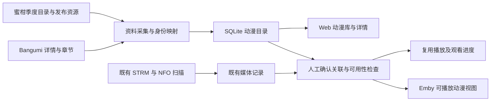

# 默认动漫库：Mikan Project + Bangumi 接入实施计划

更新日期：2026-10-12。状态：**首版代码已实现，Web 主路径与 Emby 接口已验证；目标 Emby 客户端、Linux 运行环境及发布验收待完成**。各阶段的剩余项见第 12 节，最新证据见第 18 节。

本计划落实已确认范围：新增默认“动漫库”，支持浏览番剧、查看详情和发布资源；只有关联了已有可用媒体的条目才提供播放。沿用 Go、SQLite、现有缓存、Vue 管理端和 Emby API，不引入自动下载系统。

实施基线：`79496218b9a1643b04c00c52a9b8d748c2edf511`。源码版本以 Git 提交记录为准，尚未部署或正式发布。第 2 节描述实施前的现状，第 12、18 节记录实现后的事实；未验收的目标仍按待办处理。

本文是本功能的计划与进度入口。阅读范围和体验看第 1、3、10 节；实现者按第 4—9 节落实契约，按第 12 节推进；验收与交接使用第 13—16 节。后续“按计划继续”从第 12 节第一个未完成阶段开始，不重新制定另一套计划。

## 1. 已确认范围与首版边界

### 1.1 用户能完成什么

- 首次进入媒体库即可看到一个默认“动漫库”，无需填写本地目录，也无需先生成 NFO。
- 浏览当季番剧，切换年份、季度、星期；搜索番剧，查看标题、简介、封面、评分、放送信息与剧集。
- 查看蜜柑发布资源，包括字幕组、原始发布标题、集数或合集范围、分辨率、字幕、文件大小、发布时间、来源页及磁力／种子链接。
- 把已入库媒体关联到具体剧集或剧场版，检查资源可用性，再通过网页播放器或 Emby 客户端播放。
- 清楚区分“有资料”“有发布资源”“已关联媒体”“可播放”“资源暂不可用”。
- 手动刷新资料、调整来源配置、关闭动漫库；网络故障时仍可阅读已有资料。

### 1.2 首版明确限制

| 项目 | 首版范围 |
| --- | --- |
| 在线目录 | 蜜柑季度目录、公开搜索与番组资源；Bangumi 搜索、条目详情和章节资料 |
| 节目类型 | Web 支持 TV、OVA／ONA、特别篇、剧场版；Emby 展示规则见第 9 节 |
| 播放来源 | 已在当前项目入库且可见的、单一 HTTP/HTTPS `.strm` 媒体记录 |
| 实体视频文件 | 不新增直接扫描或托管 `.mkv`、`.mp4` 的能力；这类文件须已有可用 HTTP 服务及对应 STRM 才能复用 |
| 多个发布版本 | 同集可以展示多条字幕组／清晰度发布；首版每个播放单元只绑定一个当前媒体记录 |
| 订阅与下载 | 不接入个人追番订阅、自动下载、BT 播放、qBittorrent、Aria2、PikPak 或 115 |
| 整理和写回 | 不自动创建、改写 NFO／STRM，不移动媒体，不对既有文件重命名 |
| 用户体系 | 沿用当前管理员与本地 Emby 用户模型，不扩展多用户隔离、Bangumi 收藏同步或 OAuth 登录 |
| 全站数据 | 不在启动时抓取全历史，不镜像整站图片；历史季度、搜索和详情按需获取 |
| 跨季归并 | 首版按 Bangumi 独立条目组织；续作关系可展示，不自动合并成一个超长系列 |

本期“默认库”指一个持久的系统媒体库入口，可关闭但不因重启被重新开启。“后台同步资料”不等于订阅追番或自动下载。

## 2. 当前实现与参考证据

### 2.1 实施前的项目能力

| 现状 | 本次影响 |
| --- | --- |
| 扫描发现 STRM 后读取 NFO，写入电影索引 | 在线条目需要自己的入库路径，不能制造假 STRM 交给扫描器 |
| `libraries.path` 必填且唯一，库类型在响应中固定为 movies | 需要区别目录库和在线库，以及库的数据来源与内容类型 |
| Emby 条目主要为 Movie；Series/Episode 请求返回空，NextUp 目前为空实现 | 需要真实的番剧层级和后续播放查询，不能只改类型字符串 |
| 播放入口检查 STRM 可读和 HTTP/HTTPS 地址格式 | 需要另外建立有时效的媒体可用性检查；格式合法不等于视频可访问 |
| 用户进度、已看、收藏等依赖原 movie_id | 在线剧集的播放入口须解析回同一媒体身份，避免两套进度 |
| 已有后台任务、计划任务、取消、缓存版本、前端请求生命周期 | 复用这些机制，新增动漫同步职责，不重复建立第二个调度系统 |
| 实例配置与刮削配置已有显式保存模式 | 新设置必须保留草稿、显式保存、恢复和并发修改保护 |

### 2.2 两个参考项目采用的能力

- **Ani-Go**：蜜柑 RSS、搜索、季度目录、字幕组入口；Bangumi 条目和章节接口；发布标题解析。借鉴采集、解析与分工，不引入其下载器、AI、插件和通知体系。
- **AnimeX**：蜜柑发布搜索与时间表，Bangumi 元数据，番剧／剧集／媒体文件的分层。借鉴浏览和资源关联，不引入其 MySQL、多储存桶与用户申请流程。
- 两个项目的 README 功能描述不直接当作已验证能力；本次参考已读取的相关源码。实施按官方 API 和实际响应确定字段，尤其不得把 Bangumi 的 subject `type` 当成 TV／Movie 分类；动画类型与媒介 `platform` 是不同概念。
- 代码以自行实现当前项目适配为主；需要复用外部代码时先核对对应提交的许可证并保留要求的署名。Ani-Go README 声明 MIT，但本次读取的树中未见根 LICENSE，不能只凭徽章判定具体代码可复制。

### 2.3 已完成的只读验证

- 蜜柑 `https://mikan.tangbai.cc/Home/Bangumi/4063` 页面包含 Bangumi `https://bgm.tv/subject/418229` 的明确链接。
- `https://mikan.tangbai.cc/RSS/Bangumi?bangumiId=4063` 无账号请求可返回该番组的公开发布条目和 torrent enclosure。
- Bangumi `/v0/subjects/418229` 与 `/v0/episodes?subject_id=418229&limit=2&offset=0` 可返回详情及单集数据。
- 这说明公共数据链路可访问，不代表所有条目都有对应关系、历史 RSS 完整、镜像永远可用或播放链路已经通过验收。

## 3. 目标体验与数据流

进入媒体库后，普通目录库与默认动漫库并列。动漫库打开独立的番剧页面，不套用电影墙的番号、厂商等专用筛选。页面先显示已保存资料，再根据过期情况更新。



典型路径：当季列表 → 番剧详情 → 查看第 1 集和多个字幕组版本 → 关联现有媒体 → 检查通过 → 播放。只有磁力或种子时，可以复制链接或打开来源页，不能将该发布记录标记为“可播放”。

## 4. 数据权威、身份与存储

### 4.1 数据归属

| 数据 | 权威来源 | 更新规则 |
| --- | --- | --- |
| 现有目录库影片元数据 | NFO | 保留当前扫描与手动编辑规则 |
| 动漫条目标题、简介、评分、章节 | Bangumi | 保存来源、更新时间和上次成功快照 |
| 蜜柑目录、字幕组与发布资源 | 蜜柑 | 保留源站原始名称；不覆盖 Bangumi 的规范章节身份 |
| 蜜柑到 Bangumi 的关联 | 明确来源链接或管理员确认 | 自动获取不能覆盖管理员修正 |
| 剧集到媒体记录的关联 | 管理员确认 | 名称匹配只提供候选；首版不自动绑定播放源 |
| 播放地址 | 当前关联媒体的 STRM | 播放时重新读取，不能持久保存带签名的直链作为真源 |
| 进度、已看与单集收藏 | 原媒体记录的 userdata | 动漫入口与原入口读写同一记录 |
| 可用性 | 实际媒体检查结果 | 带检查时间和错误分类，过期结果重新验证 |

在线读取可更新缓存和外部资料快照，但不能写 NFO、改变关联、触发下载或修改用户状态。对外资料不能通过同步覆盖用户建立的关联。

### 4.2 媒体库模型

在当前媒体库模型上增加来源维度：`source_type=nfo_directory|anime_catalog`；保留内容类型作为独立维度，不能把 `anime` 填进既有 `movies/tvshows` 语义字段。

- 目录库：路径必填，参与扫描、监听、元数据重建。
- 动漫库：路径为空，固定 `system_key=builtin:anime`，不参与目录遍历和 NFO 写入任务。
- 默认名称“动漫”，允许改名；系统键及内部库 ID 不随改名、来源域名或排序改变。
- `system_key` 建唯一约束，初始化幂等；首次创建为启用，之后尊重用户关闭状态。
- 数据库层让 `path` 支持 NULL；旧目录库 API 的 `Path` 字符串格式不变，在线库返回空值并提供类型／能力字段。
- 在线库在 UI 使用“刷新资料”“设置”“关闭”，不显示文件夹扫描、探测、刮削等不适用操作。
- 普通删除库接口不得把系统动漫库当作目录库级联删除；关闭只隐藏入口并停止同步，保留资料与关联。首版不提供一键清空全部动漫数据。

`libraries` 改变非空约束需要受控迁移，不能忽略 DDL 错误。迁移先于服务、监听器及后台回填启动；保留全部旧 ID、索引和外键关系，使用专用连接和事务，并按 SQLite 的外键切换规则在事务外处理连接设置。完成后执行完整性及外键检查；失败回滚、报错，不继续以半升级状态运行。

### 4.3 拟新增的数据实体

以下是职责和关键约束，实施时以迁移与类型定义为准，不要求为了名称预先创建空文件。

| 实体／建议表 | 关键内容与约束 |
| --- | --- |
| `anime_subjects` | 本地 ID、唯一 Bangumi subject ID、标题／别名／简介／封面／评分／platform／日期、资料版本与成功时间 |
| `anime_episodes` | 本地 ID、subject 外键、唯一 Bangumi episode ID、原始 ep/sort/type、名称／简介／日期、持久 Emby 季集映射 |
| `anime_mikan_entries` | 本地 ID、来源命名空间、mikan ID、季度／星期、原始标题与封面、可空 subject 外键、关联依据与人工锁定；来源命名空间 + mikan ID 唯一 |
| `anime_releases` | 蜜柑发布 ID／infohash、所属目录条目、原始标题、字幕组、链接、大小、时间、解析属性与解析状态；来源 + 发布 ID 唯一 |
| `anime_release_episodes` | 发布与章节的关系，可多对多；支持合集；不确定关系不强填集号 |
| `anime_media_bindings` | 剧集或剧场版目标、原 movie_id、确认来源、revision、可用状态与检查时间；目标唯一，movie_id 首版唯一 |
| `anime_sync_state` | 来源 + 范围的最后尝试／成功时间、版本、ETag／Last-Modified、错误、下一次可重试时间与已完整提交的分页位置 |

关联表中 `episode_id` 和剧场版 `subject_id` 必须恰有一个非空，并有真实外键；不要用无法检查的任意字符串模拟实体约束。每个播放单元首版只允许一个关联，替换使用 revision 检查并在事务中完成。

索引围绕本期实际查询建立：季度／星期／名称、subject 下章节顺序、条目下发布时间、绑定的 movie_id、同步范围键。不增加泛用插件注册表或通用图数据库。

### 4.4 身份和分类规则

1. 蜜柑 ID 与 Bangumi ID 不相等，分别保存；已实测的 `4063 → 418229` 是映射示例。
2. 优先解析蜜柑页面明确的 Bangumi subject 链接。没有明确链接时可以检索中文名、原名和别名，但结果只作为候选，需要确认。
3. 未关联 Bangumi 的蜜柑条目仍可展示基础资料及资源，状态为“资料待匹配”；不伪造 Bangumi 身份，不将其发布标题当作官方章节。
4. 主体使用 Bangumi 唯一 ID 去重；同一主体可以关联多个蜜柑目录条目。由蜜柑入口跳到已匹配主体时保留旧入口可解析，避免收藏的页面失效。
5. 默认源命名空间为一个已验证的蜜柑数据集。更换同源镜像不改身份；接入独立数据集时必须使用新命名空间，不能因数值 ID 相同而串资料。
6. 每个 Bangumi subject 独立展示；TV／OVA 等映射为 Series，正片为 Season 1，特别篇为 Season 0；剧场版按 Movie。具体类型取官方字段和明确媒介信息，未知类型先保留 Web 展示。
7. 章节保存原始十进制 ep/sort 值，不能直接转整数吞掉 12.5 等编号。Emby 所需整数季集号独立持久保存；特殊编号映射至特别篇并保留原始显示名，歧义在上线前确认。
8. 上游章节排序变化不重建本地 ID、不重排已经发布的 Emby ID。章节删除／合并先标记状态，不删除已有媒体关联。
9. 重复抓取同一发布不能生成重复条目；相同 infohash 的来源别名可以聚合，但不同字幕版本必须保留。RSS 的 guid 可能只是发布标题，不能作为可靠唯一键，应解析发布页 ID／infohash。

Web 目录 DTO 的 entry ID 明确区分规范主体和待匹配蜜柑条目，例如 `subject:<local_id>` 与 `mikan:<local_id>`；不直接把两个站点的裸数字混用。未匹配条目完成关联后，旧入口仍能解析到新主体。列表排序和分页不能改变这些身份。

### 4.5 数据迁移与恢复约束

- 新增明确的动漫 schema 版本与幂等迁移步骤，不能沿用“忽略 ALTER 错误”的方式处理库结构重建。
- 全量扫描、目录库重建、目录不存在和配置重新加载都不能删除在线目录或将其注册为监听目录。
- 删除原媒体时清除相应绑定并使动漫投影失效；保留在线资料。文件移走而索引尚在时先标记不可用，不能播放别的路径。
- 新增在线关联不能通过重读 NFO 恢复，因此数据库成为这些关系的必要备份；只备份 NFO 不足以恢复动漫库。
- 新功能不会为原有媒体生成第二份 movie 行，也不会把媒体从原目录库迁走。

## 5. 采集、同步与缓存

### 5.1 蜜柑适配

- 基础地址默认采用本次验证的 `https://mikan.tangbai.cc`，允许管理员显式修改；不把该地址表述为已确认的官方域名。
- 季度目录读取公开页面／相应片段接口；搜索读取公开搜索结果；详情解析 Bangumi 对应关系、字幕组和来源链接。
- 公开番组 RSS 用于补充和更新发布记录；历史列表不能只靠 RSS。首版资源页面显示已获取范围和来源入口，不承诺站点所有历史发布都完整。
- HTML 用结构化解析器；XML 使用标准解析器。Go 已间接依赖 `x/net`，可优先评估其 HTML 解析能力，需要时转为直接依赖，不为复制参考项目而引入整套框架。
- 相对链接按本次请求的有效来源地址解析；处理 HTML entity、RSS 命名空间、编码、空字段、重定向和非预期 Content-Type。
- 记录原始标题；分辨率、字幕、编码、集号属于解析结果，解析失败仍保留资源，不假造字段。
- 时间保留来源原文；有时区的时间转为 UTC 保存，无时区的放送日期保留日期语义。蜜柑无时区发布时间的解释在 P0 核对并固定为来源规则，不能随部署机器时区变化；展示按用户／服务既有规则，计划任务沿用现有服务器时区语义。
- 发布全集、合集范围、SP／OVA、v2、字幕组不同命名分别建立夹具；缺少可核验对应时不写章节关系。
- 首版不需要蜜柑登录、Cookie 或个人 RSS token，不通过备用镜像传递用户凭据。

### 5.2 Bangumi 适配

- 使用官方公共 API，设置可识别的 User-Agent；普通公开条目无需账号即可获取，受限制条目遵循上游返回规则。
- 支持 subject 搜索、详情、章节分页；可使用关系接口展示续作，但不自动合并。
- 优先中文名，缺失时原名回退；评分为 0／空和“未评分”区分，日期／集数未知时显示未知。
- 章节需要读取完整分页，保存 episode ID 和原始章节类型；单页失败不能把此前完整列表替换为截断列表。
- 不把 Mikan 和 Bangumi 搜索分页当成同一排序的全站分页；响应说明来源、已加载范围及是否还有下一页。
- API 失败不以蜜柑标题覆盖已经成功取得的 Bangumi 资料，保留两者来源字段。

### 5.3 刷新范围与默认节奏

下面是首轮工程默认值，P0 记录实测后可在本文调整；不是上游允许速率的声明。

| 数据 | 默认刷新策略 |
| --- | --- |
| 当季目录 | 首次打开加载；之后每 6 小时后台检查 |
| 历史季度 | 用户打开时按需获取；成功快照 7 天内复用 |
| 番剧详情和章节 | 打开时按需补齐；连载条目缓存 24 小时；旧条目 7 天 |
| 发布列表 | 打开详情时检查；缓存 30 分钟；后台只刷新最近访问或有媒体关联的当季条目 |
| 搜索结果 | 短缓存 15 分钟，保存实际打开的条目；不把每次搜索全量长期入库 |
| 媒体可用性 | 与外部资料缓存独立，见第 7 节 |

首次启动只完成库初始化，不等待外网、不同步整季详情。首次进入页面触发首批目录加载。默认定时任务在库启用且具备成功目录快照后运行，首版每轮最多补充 100 个条目，分页推进；用户关闭库或定时更新后停止，不在重启时重建被停用的开关。

每个来源先限制 2 个并发、每秒至多 1 次请求，并在来源之间独立限流；单请求默认 15 秒；429 尊重 Retry-After，5xx／网络错误有限退避重试，403／格式变更直接报告。冷详情先返回已有数据和加载状态，不让多个串行外部请求拖住页面。

### 5.4 提交、缓存和并发规则

- SQLite 保存规范资料和成功快照；沿用现有缓存后端加速响应，Redis 不承担唯一持久真源。本计划不改变项目当前 Redis 启动策略。
- 使用来源、配置 revision、查询范围组成请求键；并发相同请求合并，页面取消不破坏其他读者共享的刷新。
- 网络获取和解析在事务／全局任务锁外执行；短事务提交校验配置代次、目标 revision 和任务取消状态，旧请求不能覆盖新来源或人工关联。
- 同一来源范围只执行一轮刷新；其他同范围请求共享结果或收到明确 busy 状态。不能借用 NFO 写入互斥锁来串行整个网络同步。
- 完整解析成功后更新范围快照；分页检查点只在该页原子提交后推进。部分失败保留已完成新增，但不能发布不完整“全量替换”或批量删除旧记录。
- 同步的主动作是增补、更新和显式标记；RSS 中消失不代表资源被删除，网络错误也不代表条目不存在。
- 页面有缓存时立即展示，后台刷新失败显示“资料暂未更新”；没有缓存时显示可重试错误，与真正空列表区分。
- 图片使用独立、有限缓存，按内容／来源版本产生 ImageTag；只抓当前需要的封面。缓存清理不能删除媒体文件、关联或用户状态。

## 6. 已有媒体关联

管理员在剧集或剧场版详情选择“关联已有媒体”，系统检索当前可见媒体记录，展示标题、所属目录库、文件名和既有关联状态。

首版采用候选预览 + 显式确认。可用标题／别名、文件名中的 SxxExx 和集数提供排序，但不能把字符串相近当成自动确认。已确认关系独立保存，后续资料刷新不重置。

关联规则：

1. 只接受当前可见且位于启用目录库的媒体；缺 NFO 的 pending、已删除、禁用库条目不能直接作为可播放来源。
2. 原媒体 ID 保持不变，原目录归属、NFO、STRM、海报和资料不改写。
3. 一集绑定一个原媒体记录；同一记录首版不同时绑定多个集或另一部剧场版。合集 torrent 不会自动成为某集的播放源。
4. 首版不拆分多集单文件，不把 CD 分段自动映射成剧集；多段或多集单文件候选标为不支持此关联，原入口保持原播放能力。
5. 确认请求携带关系 revision；过期提交返回 409，重新展示现状，防止多个页面覆盖关联。
6. 解除关联只删除关系与检查结果，保留原文件、原媒体和观看数据。
7. 替换关联前展示新旧媒体。替换后沿用新媒体已有进度，不自动复制或覆盖两份观看历史；页面说明这一行为。
8. 关联、解除、删除原媒体、切换库启用状态，都使相关动漫列表、详情、Emby 投影和图片版本按范围失效。

## 7. 播放、可用性与观看状态

### 7.1 状态定义

资料是否完整、资源是否发布、媒体是否绑定和能否播放是独立维度，不能继续共用一个 movie.status 字符串。

| 媒体状态 | 条件 | 页面行为 |
| --- | --- | --- |
| unbound | 没有确认的原媒体关系 | 显示关联入口，不显示播放 |
| unchecked | 有关联但未通过检查，或关系／源版本已变化 | 显示“检查可用性” |
| checking | 正在检查 | 显示检查中，防止重复请求 |
| playable | 上次检查成功，关系和 STRM 内容版本仍一致，尚无明确故障 | 显示播放与上次检查时间；过期时先复核再开始播放 |
| unavailable | 文件缺失、非法协议、远端拒绝等明确失败 | 显示原因和重试，不显示有效播放入口 |

成功检查可直接复用 10 分钟，超过后标记检查证据过期，在详情打开或进入播放前重新检查。时间经过本身不证明源失效，不能让整个 Emby 库每 10 分钟突然清空：列表按最后已知可播放且源版本未变的集合投影，第一次未检查和明确失败的项不投影；复查在有界后台队列或播放入口完成，列表不逐项等待外网。已有详情链接仍可读取资料，并在源失效时返回明确错误，不重新分配 ID。

这里的“可播放”表示已经关联并验证过媒体来源，不承诺外网实时可达；源变更、明确失败和过期后的播放前复核共同避免用过时直链启动播放。UI 必须显示上次检查时间，不能把旧检查伪装成刚刚验证。

### 7.2 有界检查与播放复核

- 先检查原媒体仍可见、源文件可读、STRM 非空且为受支持 HTTP/HTTPS 地址；记录源内容摘要，不记录带签名直链到日志。
- 使用有超时、重定向上限和读取字节上限的 Range GET 检查。最终选择直接检查少量正文，不依赖 HEAD；即使服务端忽略 Range，也只读取上限字节并关闭响应。
- 验证状态码和内容类型／少量媒体特征，识别 200 HTML 登录页、错误页、种子文件等；不将“任意 URL 返回 200”判为视频可播放。
- 建议检查超时 8 秒、重定向最多 3 次、读取最多 64 KiB；这些上限经 P0 样例验证后锁定。首版不在列表刷新中运行 ffprobe 或下载完整文件。
- 可用检查证明当时可访问，不保证浏览器或客户端支持其编码；编码不兼容使用播放器现有失败反馈，不显示“已经端到端验证”。
- 实际播放重新解析绑定和当前 STRM。签名地址过期或源内容变化时重新检查，不能使用上一次检查缓存的 URL；播放 API 无法解析时不返回虚假的 MediaSources。
- Web 复用现有 Artplayer 和代理回退，Emby 复用 PlaybackInfo 与流入口；本期不增加转码。

### 7.3 稳定 ID 和观看状态

- 新的动漫条目有独立、稳定且与旧数字 ID 不冲突的外部身份，建议使用 `anime-series:<local_id>`、`anime-season:<subject_id>:<season>`、`anime-episode:<local_id>`、`anime-movie:<subject_id>`；P0 必须验证目标客户端接受这些 opaque ID。
- 由一个统一解析入口将动漫播放项解析为原 movie_id、当前 SourcePath 和展示用 ItemId；PlaybackInfo、stream、代理、播放上报、已看、收藏、评分、Resume 都走相同映射。
- 显示给客户端的 ItemId 保持动漫 ID；数据库读写的进度仍归原 movie_id。因此从两个入口打开同一来源，观看进度一致。
- Series／Season 的播放数量和未看数量从当前可播放子项聚合；单集用户状态复用原记录。番剧整体追番／收藏不属于首版新增功能，不对不支持的整季操作伪造成功。
- 全局 Resume／Latest 等列表按原媒体身份去重；有有效动漫映射时采用动漫项作为全局展示，明确按原目录查询时仍返回原项。
- NextUp 从用户已开始观看的系列中选择按映射顺序排列的下一部未看且可播放正片，排除特别篇和纯在线目录；正在观看的集优先进入 Resume。

## 8. 服务端接口与模块边界

### 8.1 已实现的管理端接口

以下路径已实现；沿用 `/api/admin` 鉴权和现有错误处理。对外 DTO 不直接透传上游 HTML 或完整原始 JSON。发布筛选首版使用一个 `filter` 文本字段检索标题、字幕组、分辨率和字幕信息。

| 方法与相对路径 | 行为 |
| --- | --- |
| `GET /anime/catalog` | 年份、季度、星期、关键词、来源及有可播放媒体过滤；返回分页、来源与缓存状态 |
| `GET /anime/entries/:id` | 规范详情或待匹配蜜柑详情，包含来源映射状态 |
| `GET /anime/entries/:id/episodes` | 正片／特别篇章节、绑定摘要、可用性；有界分页 |
| `GET /anime/entries/:id/releases` | 发布资源列表、字幕组／分辨率／字幕筛选和解析状态 |
| `GET /anime/entries/:id/mapping-candidates` | Bangumi 身份匹配候选，只读 |
| `PUT /anime/entries/:id/mapping` | revision 保护的人工身份确认或纠正 |
| `GET /anime/media-candidates` | 现有媒体候选，只读、不改绑定 |
| `PUT /anime/bindings/:target` | 确认或替换唯一媒体关系，target 可解析为剧集或剧场版 |
| `DELETE /anime/bindings/:target` | 带 revision 的解除关联 |
| `POST /anime/bindings/:target/check` | 有界媒体检查；重复请求合并，返回检查任务／状态 |
| `POST /anime/refresh` | 手动刷新季度、条目或发布列表；返回任务 ID |
| `GET /anime/progress`、`POST /anime/cancel` | 复用现有后台任务交互模式，暴露同步进度与取消 |
| `GET /anime/settings`、`PUT /anime/settings` | 读取／显式保存来源与库设置，包含 revision |
| `POST /anime/test` | 测试当前草稿来源连通性，不保存设置或更改关联 |
| `GET /anime/search` | 蜜柑公开发布搜索，返回已采集范围的分页结果 |

在线目录读取可产生资料缓存，但不得标脏原电影墙。绑定、可用性、设置和条目修改只失效真正相关的缓存域。统一响应中提供 `updated_at`、`last_success_at`、`stale`、来源可用状态和可操作错误；这些字段与真实空列表分开。

状态码区分：400 无效参数、401/403 鉴权、404 不存在或不可见、409 版本冲突／同范围忙、502 上游失败、504 超时。已有缓存的上游失败可返回 200 + stale + warning；无缓存不能伪装为 200 空集合。

### 8.2 建议职责落点

- `internal/anime/`：蜜柑／Bangumi 客户端、解析、规范身份、同步协调和资料映射；网络和状态提交各自有明确边界。
- `internal/store/`：动漫实体、绑定、范围版本与迁移；网络请求不进入数据库事务。
- `internal/server/`：动漫管理 API、默认库投影、图片和 Emby 路由适配；抽取现有媒体解析入口供两类展示复用。
- `internal/scheduler/`：继续只负责调度，由现有 runner 分发 `anime_sync` 任务；不认识 HTML、Bangumi 或 NFO 细节。
- `frontend/src/api/`、`pages/`、`components/anime/`：类型契约、列表、详情、资源表、关联对话框和设置。
- 只有请求生命周期、跨页任务、缓存和播放器真实复用的部分进入现有 composable／store；不建立空的万能数据源插件系统。

现有 Movie 模型容纳目录媒体仍合理；在线节目、章节和发布记录具有不同生命周期，应新增对应实体。必须重切的共享边界是“媒体库能力分派”和“展示 ItemId 到播放／用户状态身份的解析”，不能在每个路由中复制一遍动漫分支。

## 9. Emby 兼容范围

### 9.1 一个默认库的展示策略

Web 只有一个默认动漫库，同时包含番剧与剧场版。Emby 目标同样为一个动漫库：使用其混合内容库表达，子项为 Series 或 Movie，Series 下保持 Season → Episode。

Emby 官方文档说明 Unset 内容类型可用于混合库，但支持有限。因此 **P0 先验证准确的 CollectionType 表达、层级和目标客户端行为**，不能直接假定字符串 `mixed` 可用。若单库混合展示不成立，记录证据并回到该设计点选择分视图等替代方案，不能静默改成两个默认库，也不能把剧场版伪装成普通一集。

Emby 库只展示第 7 节定义的最后已知可播放媒体项与其父级，纯在线目录保留在 Web；未匹配资料不生成可播放剧集。过期检查在播放前复核，明确失败移出可播放集合。空动漫库返回稳定空集合，库开关控制是否出现在 Views。

### 9.2 必须打通的契约

| 链路 | 必要行为 |
| --- | --- |
| Views / VirtualFolders / VirtualFolders Query | 稳定库 ID、名称、类型、封面、数量；在线库不泄露伪造磁盘目录 |
| Items / Users Items / Search | 正确区分 Series、Season、Episode、Movie；按库／父项过滤，分页和总数一致 |
| 单项详情与图片 | 标题、简介、评分、年份、ProviderIds、父子关系、ImageTag，远端封面通过受控图片服务 |
| Shows/:id/Seasons、Shows/:id/Episodes | 稳定季集号、ParentId、SeriesId、SeasonId、排序、分页和可见性 |
| Latest / Resume / Shows/NextUp | 从可播放集合产生结果，排除未绑定项，并按原媒体去重 |
| PlaybackInfo / stream / proxy | 解析动漫 ID 后复用实际源，失败不返回虚假流地址 |
| Sessions/Playing、Progress、Stopped | 正确写回原媒体观看状态，并刷新原库及动漫投影缓存 |
| UserData / Played / Favorite / Rating | 单集和剧场版映射到原媒体；集合层操作仅实现已声明支持的部分 |
| Counts、过滤与附加查询 | 不再固定 SeriesCount/EpisodeCount 为 0；没有对应模型的附加数据按兼容契约返回空值 |

路由保持项目当前的根路径、`/emby` 前缀及已有小写兼容方式。未知动漫 ID、错误父项、错误 UserId、不启用的库都不能退回到任意电影记录。访问令牌、图片端点和播放路由的鉴权规则保持一致。

## 10. 页面结构与交互规格

以下均为**目标结构示意**，稳定约束是入口、信息分组、状态和动作关系；具体字号、尺寸和占位文案可以沿用现有设计系统调整。

### 10.1 入口与动漫列表

媒体库管理中默认动漫库与现有库并列，卡片显示“在线资料库”、上次成功更新和库状态。侧栏增加“动漫”快捷入口，指向同一个库，避免生成两套收藏或缓存身份。

```text
媒体库
┌ 动漫 · 在线资料库 ─────────────────────────────┐
│ 蜜柑 + Bangumi     上次更新／未初始化            │
│ [进入动漫库] [刷新资料] [设置] [关闭]             │
└───────────────────────────────────────────────┘

动漫
┌ 搜索番剧…… ────────────────── [来源状态] ──────┐
│ [年份] [季度] [星期] [全部 / 已有可播放媒体]      │
├───────────────────────────────────────────────┤
│ 海报卡片   海报卡片   海报卡片   海报卡片        │
│ 名称       名称       名称       名称            │
│ 评分／放送日／可播放集数／资料待匹配              │
├───────────────────────────────────────────────┤
│ [加载更多]                更新中／缓存资料提示   │
└───────────────────────────────────────────────┘
```

- 年份、季度、星期、关键词与分页写入 URL；返回列表恢复筛选、已加载条数和滚动位置。
- 关键词搜索明确标注结果来源，搜索时不继续以“当前季度完整列表”的总数误导用户。
- 初次加载、更新中、有缓存但更新失败、真正空结果、来源不可用分别展示。失败不能闪成“没有番剧”。
- 海报失败使用稳定占位，卡片高度不跳动；图片懒加载，列表不批量读取全部详情和章节。
- 手机端筛选可换行或折叠，海报网格减少列数；整页不出现横向溢出。

### 10.2 番剧详情

```text
动漫 > 番剧名称                              [刷新资料]
┌ 封面 ─────┬ 标题／原名／别名 ────────────────────┐
│           │ 评分、年份、类型、放送时间、资料来源   │
│           │ 简介 [展开]                         │
└───────────┴────────────────────────────────────┘
┌ 剧集 [正片 / 特别篇] ───────────────────────────┐
│ 第01集 名称    可播放          [播放] [管理关联] │
│ 第02集 名称    已关联待检查    [检查] [管理关联] │
│ 第03集 名称    未关联          [关联已有媒体]    │
└───────────────────────────────────────────────┘
┌ 发布资源 [字幕组] [分辨率] [字幕] ───────────────┐
│ 原始标题／集数或合集范围／大小／发布时间         │
│ [复制磁力] [种子链接] [来源页面]                 │
└───────────────────────────────────────────────┘
```

- 剧集区域与发布资源区域分开；相同发布标题不会制造多份官方剧集。
- 可用状态和播放按钮位于同一行；待检查、检查中、不可用不能显示有效播放按钮。
- Bangumi 尚未匹配时显示蜜柑基础资料、资源及“匹配资料”入口，不渲染伪造的完整章节。
- 剧场版详情显示一个影片播放单元，不强行套正片／特别篇列表。
- 手机端封面与标题上下布局，发布资源转成信息卡，保留完整标题的查看方式。
- 简介与外部文本默认纯文本展示；不使用上游 HTML 直接生成可执行 DOM。
- 操作栏不以悬浮方式遮挡标题或相邻集数；展开简介、筛选浮层、焦点提示不能被卡片裁切。

### 10.3 关联对话框

```text
关联已有媒体：某番剧 / 第01集
┌ 搜索标题或文件名……  [目录库] ──────────────────┐
│ ○ 候选标题  所属库  文件名  已关联情况           │
│ ○ 候选标题  所属库  文件名  已关联情况           │
├───────────────────────────────────────────────┤
│ 当前选择与目标剧集；替换时显示原关联及进度提示    │
│                       [取消] [确认关联]        │
└───────────────────────────────────────────────┘
```

选择候选不立即保存；确认按钮防重复提交。无候选、候选失效、关系冲突、保存失败都保留当前上下文。关闭对话框恢复触发按钮焦点，切换剧集时禁止前一个搜索结果覆盖当前候选。

### 10.4 动漫库设置

- 管理库名称／启用状态、蜜柑地址、同步开关和刷新任务状态；Bangumi 默认使用官方地址，传输代理只复用项目确有的能力，缺失时不得声称已支持。
- 配置归属：库名称与 enabled 由 libraries 持有；来源设置保存在 SQLite 的 `anime.*` 范围；计划任务时间及 enabled 由 scheduled_tasks 持有。页面可统一展示，服务端只保留一份权威值。
- 字段修改只产生草稿；提供“保存”“恢复已保存”“测试连接”，测试草稿不等于保存。
- 保存带 revision，冲突返回 409 并保留草稿；关闭、恢复、离开未保存页面沿用现有确认方式。
- 来源设置保存后新任务使用新快照，旧任务取消或在提交前因代次过期被拒绝；库关闭不删除数据，不在刷新任务结束时重新打开库。
- 默认定时任务只创建一次，保存其系统关联标记；用户停用或删除之后不因重启重复生成。

## 11. 故障、访问边界与观测

这些要求针对新增的实际外部请求和共享状态，不扩展成全项目改造。

### 11.1 故障处理

| 情况 | 预期结果 |
| --- | --- |
| 蜜柑超时／403／页面结构变化 | 保留最后成功目录，明确来源异常；不删除绑定，不重试轰炸 |
| Bangumi 超时／429 | 使用已有详情，按限制退避；无详情时显示资料尚不可用 |
| RSS 为空或只含新发布 | 不据此删除历史发布；显示来源范围，不承诺全量 |
| 部分章节分页失败 | 不发布截断章节表，保留上一完整版本并记录失败页 |
| 切换来源时旧请求返回 | 旧配置代次不能提交结果，新的人工映射不受影响 |
| 单条资料坏数据 | 记录该条错误并处理其他条目，结果显示部分完成 |
| 原媒体删除、库关闭或 STRM 变更 | 失效相关绑定可用状态与 Emby 视图；不替换成另一部影片 |
| 进程退出或用户取消 | 取消外部请求，保留已提交数据；不把中断任务标为成功 |
| 服务重启 | 当前内存任务显示已中断／不可恢复；下一次同步从完整检查点重新核对 |
| 图片失败 | 使用旧图或占位，不阻塞文字详情，不改变节目身份 |

### 11.2 新增请求的边界

- 来源请求只由已保存的来源配置和受控路径构造，不提供任意 URL 代理接口；允许协议限定为 HTTP/HTTPS。
- 外部 HTML 提取的图片、来源页和下载链接做协议校验；服务端需要抓取时限制域名、重定向和响应体大小，防止页面内容诱导访问任意内部地址。
- 管理员配置的内网媒体服务是现有播放场景，不能以“禁用私网”破坏已有 STRM；媒体检查只接受已确认且可见的媒体记录，不能让普通请求传入任意探测地址。
- 外部图片验证 MIME、可解码类型及尺寸，避免把 HTML、SVG 脚本或超大响应当海报；缓存有数量／空间上限。
- 错误和日志不输出 Cookie、访问令牌、签名直链完整 query、管理员配置中的凭据；返回用户可操作的错误分类。
- 新的在线资料不自动进入原目录库演员索引、推荐特征或 AV 刮削候选，避免把两个资料领域混合。

### 11.3 日志和任务反馈

复用当前任务页，增加 `anime_sync`／媒体检查的可辨识状态。同步至少记录范围、来源、任务 ID、耗时、请求数、缓存命中、成功／跳过／失败数量、最后成功时间；明细保留有界失败样本。

同步结果分成功、部分完成、失败、取消、忙时跳过。库配置、人工映射和媒体绑定变化使相关域版本递增；“无变化”不刷新整库响应版本。来源状态展示最后一次成功与当前失败，不能只显示一个含义不清的更新时间。

## 12. 分阶段任务与依赖

### 12.1 总体安排

| 阶段 | 交付结果 | 依赖 | 当前状态 |
| --- | --- | --- | --- |
| 调研 | 当前代码与两个参考项目核对、公开接口样例验证 | 无 | 已完成 |
| P0 风险验证 | 锁定身份／单库混合展示／源关联的最小通路和测试夹具 | 本计划 | 接口穿刺完成；真实无映射样本与客户端待验 |
| P1 数据与默认库 | 可迁移、可关闭、与目录扫描隔离的默认库 | P0 | 已实现并测试 |
| P2 数据源与同步 | 可重复刷新、可缓存、可恢复的在线资料 | P1 | 已实现并测试；发布章节歧义保留提示 |
| P3 Web 浏览 | 列表、详情、资源与设置完整可用 | P2 | 已实现；桌面／手机主路径通过 |
| P4 关联与播放 | 已有资源关联、检查、网页播放及统一进度 | P1—P3 | 已实现；接口与浏览器通过 |
| P5 Emby 番剧兼容 | 默认库、季集、续播和播放上报贯通 | P0、P4 | 接口通过；ANI-27 实机待验 |
| P6 综合验收 | 故障、回归、性能、升级和真实客户端验证 | P1—P5 | 已完成本地验证；全量回归限制与剩余项见第 18 节 |
| P7 交付与部署准备 | 文档、备份恢复、发布产物和状态移交 | P6 | 文档和跨平台构建完成；真实部署未执行 |

实施顺序固定为 P0 → P1 → P2 → P3 → P4 → P5 → P6 → P7。普通独立开发任务可按条件拆分，但不得跳过 P0 的关键证据；本文不要求额外 agent 或跨聊天并行。

### 12.2 P0：先证明关键通路

- [ ] **ANI-01**：基线和构建入口已核对；目标 Emby 客户端及版本未定。用户已选择“先做接口测试”，不阻塞实现。
- [ ] **ANI-02**：固定可再现的蜜柑 HTML／RSS、Bangumi JSON 脱敏夹具；至少覆盖 TV、续作、特别篇、剧场版、合集、无映射、缺字段和分页。（除**无映射**样本外已完成；见下方记录）
- [x] **ANI-03**：接口证明“一个混合动漫库 → Series/Season/Episode 与 Movie → 图片 → PlaybackInfo → HTTP 源 → 进度上报”，覆盖 opaque ID、必需字段与大小写路径。客户端验收单列 ANI-27。
- [x] **ANI-04**：已锁定混合库省略 CollectionType、Season 0/1、Range GET 和原 movie_id 统一解析；实机接受情况保持待验。

阶段出口：可复用夹具、真实接口字段表、最小播放／进度证据齐备；若真实客户端暂不可访问，可先完成接口验证和独立工作，但 P0 客户端子项保持待验，P5/P6 不得宣称整体兼容完成。

#### ANI-01 实测记录（2026-10-12）

环境：Windows + WSL bash；Go 1.26.4 windows/amd64，CGO_ENABLED=0；Node v24.14.1；npm 11.11.0；ffprobe 8.1.2-full_build-www.gyan.dev。代码基线 `79496218b9a1643b04c00c52a9b8d748c2edf511`（与本计划声明一致）。

- **工作树状态（既有）**：`git status` 显示 69 个已跟踪文件被修改，但 `git diff --ignore-cr-at-eol` 为空——差异全是工作区 CRLF 与索引 LF 的换行差异，内容与 HEAD 完全一致。因此 `git diff --check` 对这 69 个文件逐行报 “trailing whitespace”，属既有状态，非本次新增。
- `go build ./...`：通过（rc=0，无输出）。
- `go vet ./...`：通过（rc=0）。
- `go test ./... -count=1`：仅 1 项失败。
  - `internal/server` `TestMediaProbe`（probe_test.go:135）：NFO 缺少 `<reframes>1</reframes>`。
  - 根因：本机 ffprobe 8.1.2 对 `internal/server/testdata/probe-sample.mp4`（h264）不再输出 `refs` 字段（改输出 `has_b_frames`），故探测结果无 reframes。测试未 skip，说明 ffprobe 可执行并能给出其余字段；这是与本次功能无关的既有失败。
  - 本计划第 13.3 节提到的 `TestProbeCircuitBreaker` 本次通过（`internal/server/mediainfo_test.go:577`），不再构成基线阻塞。
- **前端基线**：`npm run typecheck` 通过；vitest 16 个文件、201 项用例通过；`node --test scripts/build.test.mjs` 11 项通过。
- **正式构建入口**：`bash build.sh` → linux/amd64，`-tags embedui -mod=readonly -trimpath -buildvcs=false`，产物 `dist/emby-go-linux-amd64`；Windows 为 `build.bat`。脚本要求 Go 1.25+、Node 24.14.1、npm 11.11.0，与实测环境一致。
- **本环境工具链注意**：npm 为 Windows 可执行文件，经 WSL 调用时其子进程持有 stdout，导致调用方读不到输出（命令实际已执行）。执行第 13.3 节前端命令时应把输出重定向到文件再读取。
- **待补**：用户明确“暂时未确定，先做接口测试”；ANI-01 的客户端记录与 ANI-27 实机验证保留待办。

#### ANI-02 实测记录（2026-10-12）

新增 `internal/anime/testdata/`：12 个夹具共 280KB，以及可重现的抓取／裁剪工具
`refresh_fixtures.py`（记录 URL 与 User-Agent，含必需标记自检）、`README.md`（清单、覆盖矩阵、缺口、实测事实）。

- 覆盖：TV、续作、特别篇、剧场版、合集、缺字段、分页均已取得真实样本。
- **缺口**：抽样的 5 个当季蜜柑条目全部带 `bgm.tv/subject/...` 链接，未能取得真实
  「无 Bangumi 链接」样本；不靠删锚点伪造，待抓到真实样本后补入（未采到的行不得标记为已验证）。
- 脱敏：Mikan 页面匿名访问也带 `__RequestVerificationToken`，已把其 `value` 替换为
  `REDACTED`；自检拒绝仍含 `CfDJ8` 的产物。
- 裁剪只删减重复段落并留省略注释，不伪造字段；自检失败会直接报错，避免产出无法解析的夹具。

#### ANI-04 已锁定规则（实测证据）

以下均有夹具或抓取记录支持，实施按此执行：

1. **媒介分类只能取 `platform`，一律不用 `type`。** 动画条目 `type` 恒为 `2`；
   TV 与剧场版靠 `platform`（`"TV"`／`"剧场版"`）区分。同一搜索响应里 3485 是
   `platform="剧场版"`、其余是 `"TV"`，两者 `type` 都是 2。
2. **蜜柑发布唯一键 = 40 位十六进制 infohash。** `/Home/Episode/{hash}` 与
   `magnet:?xt=urn:btih:{hash}` 同值；RSS 的 `guid` 是发布标题，不可作唯一键。
3. **章节身份用 Bangumi episode `id`，排序用 `sort`，编号按十进制保存。**
   特别篇 `type=1`、`ep=0`、`sort` 为小数（570.5／762.5／1076.5）——`ep` 不能当集号，
   也不能把 `sort` 转整数。特别篇映射 Season 0，正片 Season 1（与计划 4.4 一致）。
4. **蜜柑时间规范值取 RSS `pubDate`／表格视图，固定解释为 UTC+8。**
   同一发布的列表视图与其余两种渲染恒差 8 小时；两者不得混用。
5. **`data-dayofweek` 不是纯星期**：0=星期日、1..6=星期一..六、7=剧场版、8=OVA，
   且分块不按值排序。星期筛选与类型映射必须分开处理，不能用 ISO 星期语义。
6. **蜜柑条目锚点用 `href="/Home/Bangumi/N"`。** OVA 分块只有前 2 个条目带
   `data-bangumiid`，按后者解析会静默漏掉 82/84 个 OVA 条目。
7. **磁力只在 HTML 的 `data-*` 属性里**；`href` 指向第三方 `keepshare.org` 跳转，
   不是发布源，不得当下载入口（与计划 11.2 的协议校验要求一致）。
8. **体积上限是硬约束**：蜜柑搜索一次 `?searchstr=魔法少女` 返回 1000 行／4.4MB，
   长寿番页 1.5MB。响应需有大小上限，搜索结果不得全量长期入库。

9. **最终接口表达**：单一 CollectionFolder 省略 `CollectionType`，`Locations=[]`；TV／OVA／WEB 是 Series → Season → Episode，剧场版为 Movie，不制造磁盘目录。根路径、`/emby` 与小写路径均有契约测试。
10. **源检查与身份**：只接受启用目录库中的可见单文件 HTTP(S) STRM；直接 Range GET，8 秒、最多 3 次跳转、64 KiB 上限，识别媒体正文。动漫展示 ID 解析回原 movie_id，进度只存原 userdata。

**仍待验证**：具体 Emby 客户端对省略 CollectionType 和 opaque ItemId 的接受情况，见 ANI-27。

### 12.3 P1：数据模型与默认媒体库

- [x] **ANI-05**：实现版本化迁移、libraries 空路径与来源类型、唯一系统键；验证旧库 ID、媒体、进度、外键和失败回滚。
- [x] **ANI-06**：实现主体、章节、蜜柑目录、季度归属、发布、发布章节关系表、媒体绑定和同步状态约束。未确认的发布章节关系不自动入关系表。
- [x] **ANI-07**：默认库幂等初始化、改名、关闭和重新启用；扫描、监听、全量重建、探测、刮削和配置加载按能力分派。
- [x] **ANI-08**：设置／定时任务单一权威、revision 和来源配置代次；用户关闭状态、名称和人工绑定不被初始化覆盖。

阶段出口：升级前后现有电影／进度一致，在线库不进入文件扫描，全量重建不丢在线关系。

### 12.4 P2：来源适配与可靠同步

- [x] **ANI-09**：蜜柑季度目录、公开搜索、详情与字幕组、RSS 和页面已有历史发布；基础地址可配置，不承诺全站完整历史。
- [x] **ANI-10**：Bangumi 搜索、详情、章节分页与字段转换；缺字段保留已有非空值，分页不完整不替换章节表。
- [x] **ANI-11**：明确链接与人工映射、infohash 去重、发布属性及合集／特别篇提示；人工修正优先，歧义不自动绑定章节。
- [x] **ANI-12**：有界同步、限流、缓存、同步／搜索／封面请求合并、部分成功、取消、原子分页提交和代次检查。后台任务记录请求统计和提交批次数。
- [x] **ANI-13**：受控封面读取、ETag、旧图回退、4 个并发／32 张缓存／2 MiB 单图限制。

阶段出口：同一夹具重复同步不重复入库，失败不清空成功数据；两来源职责独立且可用真实只读样例验证。

### 12.5 P3：Web 默认动漫库

- [x] **ANI-14**：管理 API 与 TypeScript DTO、鉴权、参数校验、分页、来源状态和错误反馈。
- [x] **ANI-15**：默认库卡片、侧栏入口、列表、年份／季度／星期／来源／可播放筛选、标题与发布搜索、返回滚动及焦点恢复。
- [x] **ANI-16**：详情、正片／特别篇、剧场版、长简介展开、发布筛选与分页、外部链接和待匹配状态。
- [x] **ANI-17**：Bangumi 候选、确认／纠正、人工锁定与 revision 冲突反馈。
- [x] **ANI-18**：显式保存、两来源连接测试、恢复草稿、任务页和可停用／删除的定时同步；关闭后重启保持关闭。

阶段出口：无 NFO 的在线条目可完整浏览，资料／发布／播放状态分明；桌面与手机主路径通过真实 Go 服务验收。

### 12.6 P4：关联已有媒体并播放

- [x] **ANI-19**：候选预览与不适用原因、唯一绑定、替换／解除、revision 和原媒体删除失效。
- [x] **ANI-20**：可用性状态机、有界 Range GET、媒体识别、源变更和 10 分钟检查缓存；UI 显示检查时间。
- [x] **ANI-21**：统一原媒体解析，接通 Web 播放和代理回退；共享进度、收藏、已看，列表读取当前投影。
- [x] **ANI-22**：CAS／唯一约束、媒体及库失效、两入口共享状态、替换后保留各自进度的回归。

阶段出口：只有有效媒体显示播放；同一原媒体两个入口共用状态；无自动下载、无 NFO／STRM 写入副作用。

### 12.7 P5：Emby 番剧与剧场版

- [x] **ANI-23**：动漫 CollectionFolder、Series/Season/Episode/Movie、稳定身份、图片与数量。
- [x] **ANI-24**：Items、详情、Seasons、Episodes、混合类型筛选／分页、父子范围、Ids 查询与兼容路径。
- [x] **ANI-25**：PlaybackInfo、流、用户状态及播放上报；错误和未知动漫 ID 不回退到原电影。
- [x] **ANI-26**：Latest／Resume 去重、NextUp 正片顺序、可播放投影和源失效处理。
- [ ] **ANI-27**：用目标客户端验证 TV、特别篇、剧场版、播放／续播／已看、图片、空库和源失效。

阶段出口：自动化契约与真实客户端主路径均有证据；不能以 Web 播放成功替代 Emby 验收。

### 12.8 P6：回归、性能与恢复

- [ ] **ANI-28**：主要来源、迁移、同步、绑定与故障契约已通过；真实无映射样本、全部错误注入组合及客户端场景未全部覆盖，见第 18 节。
- [ ] **ANI-29**：全量 Go 回归已运行；保留 TestMediaProbe 基线失败及监听文件占用瞬态失败（单独重跑通过）。不能勾选全量通过。
- [ ] **ANI-30**：已完成 5,000／100,000／200,000 合成查询、热 HTTP 列表和 20 请求合并；大量已绑定 STRM 的 Emby 投影、长时间内存及冷启动对比仍待测。
- [ ] **ANI-31**：带媒体／进度的旧 schema 升级、迁移失败回滚、VACUUM INTO 一致性备份恢复、重启中断通过；旧二进制配旧库和实际部署环境回滚待验。

阶段出口：矩阵已验收，未通过项有明确事实和影响范围，不能通过无依据放宽断言或永久跳过新增失败结项。

### 12.9 P7：交付与发布准备

- [x] **ANI-32**：更新 README、ANIME-LIBRARY.md、THIRD-PARTY-DATA.md，以及配置、备份恢复和本计划。
- [ ] **ANI-33**：正式 Vue、Windows／Linux amd64 embedui 构建完成；新表与库开关已在本地测试，systemd／容器数据目录待实际环境验收。
- [x] **ANI-34**：交付源码、使用说明、测试证据和预览构建；未执行部署或正式发布。预览产物不等同于所有验收项通过。

阶段出口：源码、验证、文档和发布产物对应同一版本。实现完成、真实部署通过分别记录，不把生成二进制写成已上线。

## 13. 验收矩阵与质量目标

### 13.1 必验行为

| 编号 | 场景 | 验收结果 |
| --- | --- | --- |
| AC-01 | 空数据库／已有数据库连续启动 | 恰有一个默认动漫库；旧库 ID、媒体和进度不变 |
| AC-02 | 动漫库改名、关闭、重启、重新开启 | 名称和开关持久；关闭后不联网同步、不被重建 |
| AC-03 | 全量扫描／重建、监听重启、配置保存 | 只处理目录库；动漫资料、映射不被清理 |
| AC-04 | 无任何 NFO 的在线浏览 | 可以按季度搜索、打开详情和发布列表 |
| AC-05 | 蜜柑 ID 与 Bangumi ID 不同／无明确映射 | 正确关联或保留待匹配，不误绑同名续作 |
| AC-06 | 特别篇、小数编号、续作、剧场版、合集 | 保留真实类型与编号，资源与官方章节分离 |
| AC-07 | 同一 RSS／页面重复刷新，多字幕组同集 | 发布不重复，多个版本保留，不制造多份章节 |
| AC-08 | 上游 403、429、5xx、超时、HTML 变化、半页失败 | 保留成功快照，错误和重试有界，不误判删除 |
| AC-09 | 管理员修正映射后自动刷新／切换域名旧请求返回 | 人工关系保持，过时代次不覆盖新数据 |
| AC-10 | 无绑定、待检查、成功、检查过期、HTML 登录页、源 404 | 状态与按钮一致；过期不清空整个库，播放前复核；种子与登录页不算媒体 |
| AC-11 | HEAD 405、Range 被忽略、慢响应、循环跳转 | 有界回退、停止读取、可取消，不下载完整文件 |
| AC-12 | 两页同时关联、重复提交、绑定已被占用源 | 唯一约束有效；冲突明确，不覆盖另一集 |
| AC-13 | 原文件／目录库删除、禁用、STRM 修改 | 关联可用性和 Emby 投影失效，不串播 |
| AC-14 | 从原媒体入口和动漫入口播放同一来源 | 进度、已看、收藏一致，无第二份状态 |
| AC-15 | 替换／解除关联 | 文件与原记录保留，各媒体观看历史不被覆盖 |
| AC-16 | Emby 单库 TV／特别篇／剧场版浏览与播放 | 类型、父子关系、季集号、图片及播放入口正确 |
| AC-17 | Emby Resume／Latest／NextUp、空库／分页 | 不重复计同一媒体，不返回纯在线不可播放项 |
| AC-18 | 设置草稿、恢复、保存失败、revision 冲突 | 不自动保存；失败保留草稿，恢复到已保存值 |
| AC-19 | 手机布局、长标题、展开、对话框、返回 | 无遮挡溢出；焦点及列表位置恢复，请求不串页 |
| AC-20 | 任务取消／服务重启／部分已提交 | 已提交数据可用，中断不标成功，再执行幂等 |
| AC-21 | 迁移失败、异常关闭、恢复备份 | 数据库可回到完整状态，外键正确，关联不静默丢失 |
| AC-22 | 原电影／演员／刮削／探测／配置路径 | 与本功能无关的既有行为通过相应回归 |

### 13.2 性能与资源目标

以下是验收目标，不是已测结果。P0 固定机器、测试数据和测量脚本；确需调整时记录实测原因与新标准。

- 以 5,000 个节目、100,000 个章节、200,000 条发布记录作为本地合成规模；缓存热态下，单页 50 项的列表／章节／发布查询服务端 p95 目标不超过 300 ms，不计图片与外网耗时。
- 同一来源范围 20 个并发冷请求不形成 20 次相同外网请求；取消一个页面不导致其他共享请求无结果。
- 已有目录库浏览的外网请求数保持为 0；缓存热态动漫列表不能逐条发起远端媒体检查。
- 新增功能启用但未访问时不启动全站抓取；上游连续失败时请求数受限流与退避控制。
- 图片缓存、响应体、读取字节、并发、任务队列和失败样本都具有明确上限；长时间运行不按访问次数无界增长。
- 取消后等待中的任务不再提交旧数据；运行中的网络请求在 context／既定超时内退出。大批同步按有界批次让出数据库，不长期占用写事务。

### 13.3 检查层次与命令

实现时用可控 HTTP 服务和夹具覆盖错误、分页、缓存、并发；公开站点只用于少量连通性和真实字段验证，不作为每次 CI 的外部依赖。媒体使用自建小样例 HTTP 服务，不下载完整番剧验证。

在相应阶段执行适用检查：

```powershell
# 仓库根目录：对应包已实现后执行
go test ./... -count=1 -skip '^TestRedisBehavior$'
go vet ./...
go build ./...

# frontend 目录：使用 package.json 锁定的 Node/npm 工具链
npm run typecheck
npm run test:unit -- --run
npm run test:build
npm run build
$env:PW_CHANNEL='msedge'
npm run test:e2e -- anime.spec.ts

# 仓库根目录：前端正式产物已生成后
go build -tags embedui -o dist/emby-go-anime.exe ./cmd/metatube
git diff --check
```

上述路径已实现。TestRedisBehavior 是既有固定访问并清理本机 Redis DB 15 的测试，常规回归显式排除；浏览器测试使用隔离 Redis 和临时库。Linux 构建沿用 build.sh 的参数，实际运行单独验收；本次未执行 race（Windows CGO_ENABLED=0）。

此前计划记录过 TestMediaProbe、TestProbeCircuitBreaker 等环境相关基线限制。P0 应重新确认当前状态；全套失败就保留确切失败结果。必要时单列定向检查和明确跳过的基线，不写“全部通过”。历史 EPERM 也不自动等于本次阻塞，以实际执行结果为准。

## 14. 风险与先行验证

| 风险 | 首次验证阶段 | 处理与通过标准 |
| --- | --- | --- |
| Emby 混合库在目标客户端受限 | P0 | TV 与 Movie 同库可浏览；否则返回设计调整，保持待验状态 |
| 新的 opaque ItemId／层级不被客户端正确处理 | P0 | 详情、图片、播放和进度都使用稳定身份，不靠改成 Movie 绕过 |
| Mikan 页面／镜像发生变化 | P0/P2 | 多样例解析、来源可配置、失败保留快照；有明确解析失败而不是空成功 |
| 续作、SP、合集、非整数编号误配 | P0/P2/P4 | 保留原始信息，人工确认优先；歧义不会进入播放绑定 |
| libraries 迁移和老版启动逻辑触碰在线库 | P1 | 迁移失败可恢复；监听、扫描、初始化和配置重载均有类型分派验证 |
| 同一个媒体两个展示身份产生双进度 | P0/P4/P5 | 同一解析入口、原 userdata 权威；续播和全局列表去重 |
| “可播放”检查过度或不准确 | P0/P4 | 有界媒体验证、明确状态时效、不在列表逐项网络探测 |
| 配置／关联更新与外部请求竞态 | P2/P4 | revision 与代次校验，锁外网络、短事务条件提交 |
| 重建／删除／回滚丢失人工关系 | P1/P6 | 外键、隔离清理、数据库备份与实际恢复演练 |

这些风险的存在不阻止资料浏览等独立任务推进，但对应阶段出口不能在缺少证据时打勾。

## 15. 升级、回滚与交付

1. **升级前**：记录二进制版本、数据库 schema、目录库数、媒体数与用户状态样本；停写后通过 SQLite 一致性备份方式保存数据库及配置。不能在 WAL 运行时只随手复制主 `.db` 文件并声称备份完整。
2. **首次升级**：先迁移和完整性检查，再初始化默认库，最后启动监听与调度；启动不依赖外网成功。迁移失败保留旧库并停止进入新功能，不继续半升级运行。
3. **功能关闭**：停止动漫同步和检查任务，隐藏动漫入口，保留在线资料及关系；原目录库继续正常运行。
4. **备份内容**：数据库、来源配置及库开关是必要数据；海报缓存可重建。原媒体文件仍按既有方案备份，计划不会把它们复制进动漫目录。
5. **回滚旧二进制**：不假定旧版本能安全读取新 libraries 结构。保留升级后的完整数据库副本，然后恢复配套旧二进制、升级前数据库及配置；升级后产生的关系和观看变化需保留为恢复资料，不能声称旧备份包含这些变化。
6. **验证恢复**：核对默认库开关、人工关系、剧集身份、原媒体进度、一次播放及现有目录扫描；恢复后在启动同步前验证来源配置。
7. **发布说明**：写明默认库行为、外部网络需求、播放来源限制、缓存与错误提示、已验客户端和仍待验环境；不宣传自动下载或原生 BT 播放。

本计划的编写不触发提交、推送、发布或部署。实施交付时按用户指令推进相应操作，并分别记录构建完成、部署完成和真实运行验证。

## 16. 进度记录与最终完成标准

每个任务完成后在第 12 节勾选，并在这里补充简短记录：日期、任务编号、实际变更、验证命令／环境、结果和剩余限制。不要把同一状态复制到多个独立计划中。

| 日期 | 范围 | 结果 | 下一步 |
| --- | --- | --- | --- |
| 2026-10-12 | 只读调研与完整计划 | 已核对当前代码、两参考仓库相关实现；已验证一组公开蜜柑／Bangumi 对应数据；业务代码未修改，功能验收未开始 | P0 / ANI-01 |
| 2026-10-12 | P0 / ANI-01 基线复核 | 基线 `79496218` 确认；`go build`、`go vet` 通过；`go test ./...` 仅 `internal/server/TestMediaProbe` 失败（ffprobe 8.1.2 不再输出 `refs`）；前端 typecheck／201 项单测／11 项构建测试通过；工作树 69 文件仅 CRLF 差异，`git diff --check` 既有报错 | 目标 Emby 客户端版本待用户提供；随后 ANI-02 夹具 |
| 2026-10-12 | P0 / ANI-02 夹具与 ANI-04 规则锁定 | 新增 `internal/anime/testdata/`：12 夹具 280KB + 可重现抓取工具 + 自检；取得 TV／续作／特别篇／剧场版／合集／缺字段／分页真实样本；锁定 8 条实测规则（`platform` 才是媒介、infohash 为发布键、`ep`/`sort` 十进制、时间固定 UTC+8、`data-dayofweek` 混入剧场版/OVA、条目锚点用 href、磁力在 `data-*`、响应体积上限） | 补「无映射」真实样本；ANI-03／ANI-04 剩余子项待目标客户端；然后进入 P1 |
| 2026-10-12 | P1—P5 首版实现 | 默认在线库、SQLite 迁移、Mikan／Bangumi、Web 浏览、人工关系、STRM 检查与共享播放、混合 Emby API 完成；具体范围和代码见第 18 节 | 实机 Emby 保留 ANI-27 |
| 2026-10-12 | P6—P7 本地验证与构建 | 动漫定向测试、202 项前端测试、11 项构建测试、桌面／手机浏览器通过；合成规模查询 p95<3ms；已生成 Windows／Linux 预览产物。全量回归保留两项失败证据 | 真实客户端、部署／回滚、大量绑定媒体与长期运行测试 |

最终完成需要同时满足：

- [x] 默认动漫库只创建一次，能浏览资料、详情与发布资源，关闭与配置修改行为清楚。
- [x] 已验证的蜜柑／Bangumi 样本身份正确，异常与部分失败保留成功数据及人工关系；真实无映射样本仍待补。
- [x] 已有媒体关联、检查与网页播放可用，原媒体进度和数据得到保留。
- [ ] 目标 Emby 客户端可浏览所承诺类型、播放、续播及上报，纯在线资源不会冒充可播放媒体。
- [ ] 现有目录库、NFO 扫描、演员、图片、刮削、任务和设置通过适用回归。
- [ ] 数据迁移、备份、恢复及回滚有执行证据，正式构建与文档一致。
- [x] 所有待验客户端／环境被明确记录；没有把公开接口连通或构建成功当成端到端完成。

## 17. 证据与实现落点索引

### 17.1 当前仓库

| 路径 | 用途 |
| --- | --- |
| [store.go](internal/store/store.go) | libraries／movies／userdata 模型、建表、媒体库删除与用户状态 |
| [scanner.go](internal/scanner/scanner.go) | STRM 发现、NFO 入库与源地址校验 |
| [library.go](internal/server/library.go) | 原媒体库 DTO、Items 和动漫分派；动漫层级与 NextUp 见 anime_emby.go、anime_playlists.go |
| [media.go](internal/server/media.go) | 当前媒体解析、PlaybackInfo、stream 与 Web 代理 |
| [userdata.go](internal/server/userdata.go) | 收藏、评分、观看状态的原媒体身份 |
| [server.go](internal/server/server.go) | 路由、鉴权、兼容前缀与播放上报 |
| [library_watch.go](internal/server/library_watch.go) | 媒体库监听及局部刷新入口 |
| [scheduled.go](internal/server/scheduled.go) | 定时任务类型、runner 与参数归一化 |
| [scheduler.go](internal/scheduler/scheduler.go) | 调度、忙时跳过、取消和上次结果 |
| [前端路由](frontend/src/router/index.ts) | 正式 Vue 页面、登录守卫和导航 |
| [前端工具链](frontend/package.json) | 当前 Node/npm 版本和实际检查命令 |
| [实例配置说明](SYSTEM-CONFIG.md) | 显式保存、恢复、revision 与生效时机约束 |
| [NFO 扫描记录](codestable/issues/015-o-ff-nfo-only-scan.md) | 在线库必须隔离的扫描／图片按需读取边界 |
| [客户端接口记录](codestable/issues/017-x-ff-client-browse-endpoints.md) | 路径兼容、分页与查询范围的既有约束 |

### 17.2 外部参考

- [Ani-Go 蜜柑适配，db71ee1](https://github.com/xiaoyueRX/Ani-Go/blob/db71ee1b860cbd6e78d80539006f4947031c8400/internal/source/mikan.go)：目录、搜索、RSS、字幕组入口。
- [Ani-Go Bangumi 适配，同一提交](https://github.com/xiaoyueRX/Ani-Go/blob/db71ee1b860cbd6e78d80539006f4947031c8400/internal/metadata/bangumi.go)：条目与章节获取思路，字段转换须按官方契约重新核对。
- [AnimeX 蜜柑适配，d737832](https://github.com/YinBuLiao/AnimeX/blob/d737832498da360622b9a37aee20b2fb99f76e48/internal/mikan/mikan.go)：页面解析和发布记录结构。
- [AnimeX Bangumi 适配，同一提交](https://github.com/YinBuLiao/AnimeX/blob/d737832498da360622b9a37aee20b2fb99f76e48/internal/bangumi/bangumi.go)：公开元数据与搜索。
- [AnimeX 媒体库组织，同一提交](https://github.com/YinBuLiao/AnimeX/blob/d737832498da360622b9a37aee20b2fb99f76e48/internal/web/library.go)：番剧／剧集／可播放文件分层。
- [Bangumi 官方 API](https://bangumi.github.io/api/dist/)：以实施时官方 schema 和实际响应锁定字段。
- [Emby TV 命名与混合库说明](https://github.com/embysupport/emby.docs/blob/master/TV-Naming.md)、[媒体库设置](https://github.com/embysupport/emby.docs/blob/master/Library-Setup.md)：混合库能力有限，不能替代真实客户端验证。

参考仓库和公开服务会变化，固定提交仅作为本次调研证据；实施使用的响应夹具和验证记录必须另行保存并标记取得时间。

## 18. 实现与验证记录（2026-10-12）

本节记录实际执行结果；第 13 节仍是验收目标，不能把目标表直接当成全量通过记录。测试只使用临时 SQLite／测试 Redis／本地 HTTP 媒体，没有迁移用户运行数据库，也未改写用户 NFO 或 STRM。

### 18.1 实现落点与确定的行为

- `internal/anime/`：Mikan HTML／RSS、Bangumi 分页与规范模型，HTTP 限流、重试、搜索合并与缓存，媒体和封面验证；测试夹具与第三方来源见各自 README。
- `internal/store/anime*.go`、`libraries.go`：事务 schema v1、稳定身份、季度归属、非空快照合并、绑定 CAS／唯一约束、设置及自动任务初始化。删除原媒体后外键 SET NULL，解除绑定保留 revision；上游删除章节标记非活动并保留旧关系。
- `internal/server/anime*.go`：管理 API、应用持有的同步／检查／封面任务、原媒体解析、Emby 混合视图与播放列表。普通目录查询排除在线库，跨库混合分页先排除已投影的原媒体，避免重复。
- Vue 的 AnimePage／AnimeDetailPage／AnimeSettingsPage 与两个动漫组件：季度和来源筛选、独立发布搜索、详情／章节／发布、人工映射与 STRM 关联、检查时间、播放器、显式保存草稿与冲突反馈。
- 媒体检查直接 Range GET，8 秒、64 KiB、3 次重定向，读取单文件 STRM 上限 64 KiB；检查通过不保证视频编码受所有浏览器支持，HLS 仍依赖浏览器原生能力。
- 目录 TTL 当季 6 小时／历史 7 天；详情发布 30 分钟，Bangumi 当季 24 小时／历史 7 天；首次成功目录创建 6 小时定时任务，后续最多处理 100 个近期访问或有绑定的当季条目。用户删任务不会被重建。
- 同范围同步、搜索和封面请求合并；搜索最多 8 份缓存与 8 个不同在途查询。同步最多一个范围在途；3 分钟任务、15 分钟定时批次、每 host 2 并发／1 请求每秒／最多 3 次尝试。图片最多 32 张，每张 2 MiB；上游资料响应 8 MiB。
- 来源状态有 success／partial／failed／cancelled／interrupted，最后完整成功时间独立保存。最近任务和日志含范围、任务 ID、耗时、提交批次、HTTP 请求／成功／失败、缓存命中；通用任务页仍沿用既有三类完成状态。统计不是逐节目增删数量。

### 18.2 验证证据

| 验证 | 实际结果与边界 |
| --- | --- |
| Go 动漫定向用例 | `go test ./internal/anime ./internal/store ./internal/server -run 'TestAnime\|TestMikan\|TestBangumi\|TestMediaCheck' -count=1` 通过；覆盖解析、完整分页、失败保留、人工优先、代次拒绝、检查、图片和混合 Emby 接口 |
| 存储与迁移 | 迁移前预置旧库、媒体和 userdata；验证 ID／进度不变、失败回滚、关闭与改名重启保留、唯一绑定及 tombstone revision；VACUUM INTO 恢复后关系／收藏及完整性／外键检查通过 |
| 身份与进度 | Series／Season／Episode／Movie、图片／PlaybackInfo／stream、根／emby／小写路径、Ids、父子校验、混合类型分页、Latest／Resume／NextUp、两入口共用状态、替换来源历史独立均有接口用例 |
| HTTP 和权限 | 未登录／错误令牌 401、参数 400、未知条目 404、设置旧 revision 409、关闭库拒绝访问；403、长 Retry-After 429、响应过大、503 退避取消、搜索共享与读者取消都有定向用例 |
| Vue | `typecheck`、17 个测试文件／202 项单元测试、11 项构建测试、正式 Vite 构建通过 |
| 真实浏览器主路径 | 使用已安装 Edge，桌面 1280×800 和手机 390×844 两项通过；真实 Go／独立 Redis／临时 SQLite／HTTP 媒体，从浏览到绑定、检查、视频 readyState≥2、共享进度、保存／恢复／关闭、服务重启均通过；无 pageerror／横向溢出 |
| 全量 Go 回归 | `go test ./... -count=1 -skip '^TestRedisBehavior$'` 完成，但未全绿，具体失败见下文；保留既有断言 |
| 静态检查与构建 | `go vet ./...`、`go build ./...`、Windows embedui、Linux amd64／CGO=0／GOAMD64=v1 embedui 通过；未执行 Linux 服务启动、systemd／容器或 race |

最新全量回归保留两项失败：

1. `TestMediaProbe`：`probe_test.go:135` 缺 `<reframes>1</reframes>`；与 P0 的 ffprobe 8.1.2 基线相同。
2. `TestMonitorRegistersMovedTreesAndRecoversRoot`：Windows 创建目录时返回 “The process cannot access the file because it is being used by another process”，导致未及时监听新子目录；单独执行同一用例通过（1.761 秒），记录为瞬态失败，没有修改监听实现或弱化断言。

全套中的 TestProbeCircuitBreaker、扫描／NFO／刮削／配置等其余包检查通过。`TestRedisBehavior` 会清理固定本机 Redis DB 15，常规回归因此显式跳过，不能称已验证该测试。

本机日志：`%TEMP%/emby-anime-targeted.log`、`emby-anime-final-go.log`、`emby-anime-monitor.log`、`emby-anime-unit.log`、`emby-anime-e2e.log`、`emby-anime-scale.log`。浏览器截图在 `frontend/test-results/anime-*/anime-catalog.png` 与 `anime-detail.png`，属于忽略的本地证据，不随 Git 自动交付。

### 18.3 性能实测

机器：Intel Core i7-13650HX，Windows／Go 1.26.4，本地临时 SQLite。可复现命令：

```powershell
go test ./internal/store -run '^$' -bench '^BenchmarkAnimeCatalogScale$' -benchtime=100x
go test ./internal/server -run '^$' -bench '^BenchmarkAnimeWarmCatalog$' -benchtime=100x
```

合成库包含 5,000 个节目、100,000 章节、200,000 发布；每节目 20 章节／40 发布。100 次查询的 p95：目录单页 50 条 **2.530 ms**，章节列表 **0.5462 ms**，发布查询 limit=50 **0.5728 ms**，均低于 300 ms 目标。另有 2,000 条目录的实际 HTTP 热列表平均约 **1.83 ms**。数据集为合成资料，未绑定媒体，不代表大量 STRM／网络盘上的 Emby 投影性能。

同范围目录刷新和搜索分别验证 20 个读者只产生一次相同上游请求；取消一个搜索读者仍保留共享结果。列表通过本地状态与 STRM 检查投影，没有逐项发起远端检查。尚未实测长时间内存曲线、冷启动对比及大规模已绑定媒体库。

### 18.4 交付与下一步

- 使用说明：[ANIME-LIBRARY.md](ANIME-LIBRARY.md)；来源和代码参考署名：[THIRD-PARTY-DATA.md](THIRD-PARTY-DATA.md)。
- 预览产物：`dist/emby-go-anime.exe`、`dist/emby-go-linux-amd64`，内嵌正式 Vue 资源，版本 `anime-preview`／基线提交加 `-dirty`；SHA256 清单在 `dist/anime-preview.sha256`。生成产物不代表已部署或已正式发布。
- 用户已明确先做接口测试；**ANI-27 真实 Emby 客户端**待确定客户端和版本后验收。
- 真实无 Bangumi 链接的 Mikan 样本仍未取得；新增了明确标注的合成无映射测试，但不能代替真实夹具。
- 仍待部署环境升级／旧二进制配旧库回滚、大量绑定媒体性能、冷启动与长期容量验收。发布章节关系表保留，但只展示标题解析提示，不猜测合集到官方章节的关系。
- 下次“继续”从上述未完成验证项推进，优先使用能够确定的运行环境，不重新实现已有模块，不把未确定的客户端验收写成通过。
